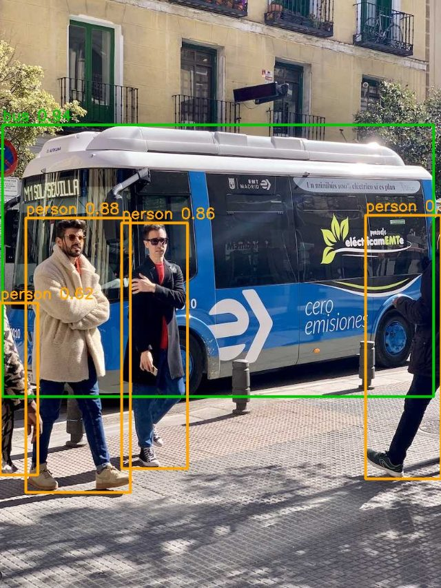
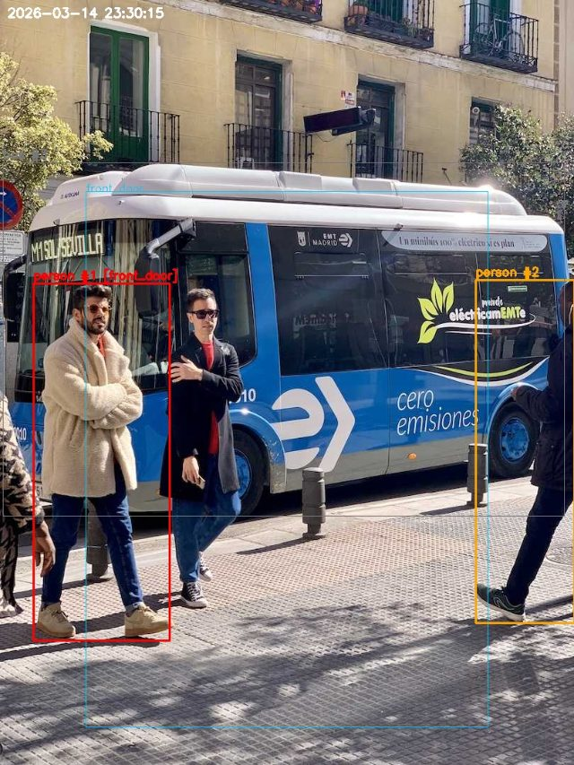

# Day 7: OpenCV for images

**Hours 19-21 of 45** · **Milestone 3:** `draw_overlay` (boxes, labels, zones, time on a frame) and `RuleEngine.zone_polygons`

## What you can do at the end of today

- Read, show, resize, convert and save pictures with OpenCV (`cv2`).
- Draw rectangles, text and polygons on a picture.
- Explain image coordinates and the box format `(x1, y1, x2, y2)`.
- Test whether a point is inside a zone with `cv2.pointPolygonTest`.
- Write the function that draws the whole "security camera view": zones, coloured boxes with labels, and the time.

## Where today fits in the project

When the Intelligence System runs, you see a window with boxes around people. When it sends an alert, the photo has the boxes and the time drawn on it. Both come from one function, `draw_overlay`, which you write today. It draws on a frame that is just a NumPy array (Day 6). You also add the code that turns a zone from `config.json` into pixels.

## Plan for the day

| Hour | Minutes | Activity |
|---|---|---|
| 19 | 5 | Warm-up: what is the shape of a 480 x 640 colour picture? |
| | 15 | Talk: OpenCV basics, show, save, resize, grey |
| | 10 | Live demo |
| | 30 | **Labs 7.1-7.2** View and transform a picture |
| 20 | 15 | Talk: coordinates and drawing functions |
| | 10 | Live demo |
| | 35 | **Lab 7.3** Draw labelled boxes |
| 21 | 15 | Talk: zones, polygons, point in polygon |
| | 10 | Live demo |
| | 35 | **Labs 7.4-7.5 (Milestone 3)** Zone test, `draw_overlay` |

---

# Hour 19: OpenCV basics

## Learn

**OpenCV** is a free library for computer vision. In Python it is called `cv2`. Its pictures are NumPy arrays, exactly as in Day 6, in **BGR** order.

| Function | What it does |
|---|---|
| `cv2.imread(path)` | read a picture file into an array |
| `cv2.imshow(title, image)` | show a picture in a window |
| `cv2.waitKey(ms)` | wait for a key (0 = forever) and let the window update |
| `cv2.destroyAllWindows()` | close all windows |
| `cv2.imwrite(path, image)` | save a picture (the file extension chooses the format) |
| `cv2.resize(image, (width, height))` | change the size |
| `cv2.cvtColor(image, code)` | change the colour system, for example to grey |

Things that surprise beginners:

1. **`imread` does not raise an error** when the file is missing or the path is wrong. It quietly returns `None`. Always check: `if image is None: ...`.
2. **`imshow` shows nothing until you call `waitKey`.** `waitKey` is what lets the window draw itself. `waitKey(0)` waits for a key press. `waitKey(1)` waits 1 millisecond, which is what a live video loop uses (Day 8). `waitKey` returns the key code, or `-1` if no key was pressed.
3. **`resize` takes `(width, height)`**, but `image.shape` is `(height, width, ...)`. The two orders are opposite!
4. **`imwrite` returns `True` or `False`.** If the folder does not exist it fails silently and returns `False`.
5. A grey picture has shape `(height, width)`: no third direction.
6. On a computer with no screen (a server, or WSL without display) `imshow` fails. Use `imwrite` and open the file instead.

## Lab 7.1: Show a picture

Create `exercises/day07/view_image.py`. Run it. A window with the bus photo opens. Click on it and press any key.

**`exercises/day07/view_image.py`**

```python
import cv2
from ultralytics.utils import ASSETS

image = cv2.imread(str(ASSETS / "bus.jpg"))
if image is None:  # imread does not raise an error when it fails, it returns None
    raise SystemExit("Could not read the image")

cv2.imshow("Bus", image)
print("Click on the picture window, then press any key to close it.")
cv2.waitKey(0)
cv2.destroyAllWindows()
```

(If you cannot see the window on macOS, look for the Python rocket icon in the Dock. On Windows it may be hidden behind VS Code.)

## Lab 7.2: Resize and grey

Make a half-size picture and a grey picture, and save both. Create `exercises/day07/resize_gray.py`:

**`exercises/day07/resize_gray.py`**

```python
from pathlib import Path

import cv2
from ultralytics.utils import ASSETS

image = cv2.imread(str(ASSETS / "bus.jpg"))
height, width = image.shape[:2]

small = cv2.resize(image, (width // 2, height // 2))  # note: (width, height) order!
gray = cv2.cvtColor(image, cv2.COLOR_BGR2GRAY)
print("original:", image.shape)
print("small   :", small.shape)
print("gray    :", gray.shape)

Path("output").mkdir(exist_ok=True)
ok = cv2.imwrite("output/day07_small.jpg", small)
print("saved small picture:", ok)
cv2.imwrite("output/day07_gray.jpg", gray)
```

```text
$ python exercises/day07/resize_gray.py
original: (1080, 810, 3)
small   : (540, 405, 3)
gray    : (1080, 810)
saved small picture: True
```

Look at the shapes. The grey picture has only two numbers, because it has one value per pixel. The small picture has half the height and half the width. Open both files in the `output` folder.

## Check yourself

1. Why must you check `if image is None` after `imread`?
2. If `image.shape` is `(480, 640, 3)`, what do you pass to `cv2.resize` to make it 320 wide and 240 high?
3. What happens if you call `imshow` and never call `waitKey`?

<details><summary>Answers</summary>

1. Because `imread` returns `None` instead of raising an error when it fails. Later code would crash in a confusing way.
2. `cv2.resize(image, (320, 240))`: width first, then height.
3. The window does not draw itself, so you see a blank or frozen window.

</details>

---

# Hour 20: Drawing on pictures

## Learn

Drawing functions change the picture **in place**. The picture is the first argument. Remember: `(0, 0)` is the **top-left** corner, `x` goes right and `y` goes **down**. Positions are `(x, y)` with **whole numbers**.

| Function | Example |
|---|---|
| Rectangle | `cv2.rectangle(image, (x1, y1), (x2, y2), color, thickness)` |
| Text | `cv2.putText(image, "hello", (x, y), cv2.FONT_HERSHEY_SIMPLEX, scale, color, thickness)` |
| Line | `cv2.line(image, (x1, y1), (x2, y2), color, thickness)` |
| Circle | `cv2.circle(image, (x, y), radius, color, thickness)` |
| Polygon outline | `cv2.polylines(image, [points], True, color, thickness)` |

- **Colours** are `(blue, green, red)`. Red is `(0, 0, 255)`. Orange is `(0, 165, 255)`.
- **Thickness** `-1` fills the shape.
- The **text position** is the bottom-left of the first letter. To put a label above a box, use `y1 - 8`, and use `max(y1 - 8, 20)` so the label stays inside the picture when a box touches the top edge.
- Float coordinates such as `10.5` cause an error. Convert with `int(...)`.
- Because drawing changes the original, make a copy first if you still need the clean picture: `drawn = image.copy()`.

## Lab 7.3: Draw labelled boxes

These numbers are the real output of a detector on the bus photo. Draw each box. Use orange for persons and green for anything else, and write the label and the confidence above each box.

**`exercises/day07/draw_boxes.py`**

```python
from pathlib import Path

import cv2
from ultralytics.utils import ASSETS

image = cv2.imread(str(ASSETS / "bus.jpg"))

# (label, confidence, (x1, y1, x2, y2)) from a detector run. You will get these yourself on Day 12.
detections = [
    ("bus", 0.94, (4, 229, 796, 728)),
    ("person", 0.89, (671, 395, 810, 879)),
    ("person", 0.88, (47, 400, 239, 904)),
    ("person", 0.86, (223, 409, 344, 860)),
    ("person", 0.62, (0, 556, 69, 872)),
]

GREEN, ORANGE = (0, 200, 0), (0, 165, 255)  # colours are (blue, green, red)

for label, confidence, (x1, y1, x2, y2) in detections:
    color = ORANGE if label == "person" else GREEN
    cv2.rectangle(image, (x1, y1), (x2, y2), color, 3)
    text = f"{label} {confidence:.2f}"
    cv2.putText(image, text, (x1, max(y1 - 8, 20)), cv2.FONT_HERSHEY_SIMPLEX, 0.9, color, 2)

Path("output").mkdir(exist_ok=True)
cv2.imwrite("output/day07_boxes.jpg", image)
print("saved output/day07_boxes.jpg")
```

```text
$ python exercises/day07/draw_boxes.py
saved output/day07_boxes.jpg
```



Look at how the loop unpacks each detection: `for label, confidence, (x1, y1, x2, y2) in detections`. It uses what you learned on Day 3 (tuples inside tuples).

**Try:** make boxes thinner, change the font scale, draw a filled circle (`-1`) at the centre of each box, or use red for persons with confidence below `0.7`.

## Check yourself

1. Which corner is `(0, 0)`? Which way does `y` grow?
2. What colour is `(255, 0, 0)` in OpenCV?
3. Why do we use `max(y1 - 8, 20)` for the label position?

<details><summary>Answers</summary>

1. The top-left corner. `y` grows downward.
2. Blue (the order is blue, green, red).
3. A box at the very top has `y1` near 0, so `y1 - 8` would be negative and the text would be drawn outside the picture. `max` keeps it at 20 or lower.

</details>

---

# Hour 21: Zones and the overlay (Milestone 3)

## Learn: zones

A **zone** is a named area of the picture, like `front_door` or `driveway`. The project uses zones to raise the severity ("a person **in the front door zone** is more serious"). A zone is a **polygon**: a list of corner points.

In `config.json` the corners are **fractions** of the picture: `[0.15, 0.25]` means "15% of the width, 25% of the height". Fractions work for any camera size. Before drawing or testing, you convert them to pixels. You did this with broadcasting on Day 6. You will put it in a method now.

Two questions about a zone:

1. **Where is it?** You need its corners in pixels to draw it.
2. **Is this person inside it?** OpenCV answers with `cv2.pointPolygonTest(polygon, (x, y), False)`. It returns `1.0` inside, `0.0` exactly on the edge and `-1.0` outside.

**Which point of a person do we test?** Not the centre of the box. A person who stands *behind* the zone, far away, can have a box centre that looks like it is inside. The point where the **feet touch the ground** is the bottom centre of the box: `((x1 + x2) / 2, y2)`.

## Lab 7.4: Point in a zone

Create `exercises/day07/point_in_zone.py`. The zone is a rectangle from `(100, 100)` to `(400, 300)`. Test three points and the feet of one box.

**`exercises/day07/point_in_zone.py`**

```python
import cv2
import numpy as np

# A zone as a polygon in pixels: a rectangle from (100, 100) to (400, 300)
zone = np.array([[100, 100], [400, 100], [400, 300], [100, 300]], dtype=np.float32)

points = {"inside": (250, 200), "outside": (50, 50), "on the edge": (100, 200)}
for name, point in points.items():
    result = cv2.pointPolygonTest(zone, point, False)
    print(f"{name:12} {point} -> {result}")

# Where does a person "stand"? At the bottom centre of the box, where the feet touch the ground.
box = (150, 120, 250, 280)  # x1, y1, x2, y2
foot = ((box[0] + box[2]) / 2, box[3])
print("feet at", foot, "->", cv2.pointPolygonTest(zone, foot, False))
```

```text
$ python exercises/day07/point_in_zone.py
inside       (250, 200) -> 1.0
outside      (50, 50) -> -1.0
on the edge  (100, 200) -> 0.0
feet at (200.0, 280) -> 1.0
```

Notice the polygon uses `dtype=np.float32`: `pointPolygonTest` needs that type.

## Lab 7.5 (Milestone 3): `draw_overlay` and `zone_polygons`

### Step 1: `zone_polygons` in the `RuleEngine`

Open `intelligence/rules.py` and add `import numpy as np` at the top (next to the other import):

**`intelligence/rules.py`** top of the file

```python
from datetime import time

import numpy as np
```

Then add a method at the end of the class `RuleEngine`, below `is_night`:

**`intelligence/rules.py`** add inside class RuleEngine

```python
    def zone_polygons(self, frame_shape):
        """Each enabled zone as (name, polygon in pixels) for a frame of this shape."""
        h, w = frame_shape[:2]
        return [
            (z["name"], np.array([[x * w, y * h] for x, y in z["polygon"]], dtype=np.float32))
            for z in self.zones
        ]
```

It returns a list with one `(name, polygon)` pair for every **enabled** zone, with the corners already in pixels for a frame of the given shape. `frame_shape[:2]` takes `(height, width)`. Compare it with the broadcasting line from Day 6: this version uses a list comprehension, but it does the same job.

### Step 2: `draw_overlay` in `app.py`

Open `intelligence/app.py`. Add `import cv2`, the colour table, and the function. The whole file now looks like this (`Track` is from Day 5):

**`intelligence/app.py`**

```python
from dataclasses import dataclass, field

import cv2

SEVERITY_COLORS = {0: (160, 160, 160), 1: (0, 200, 0), 2: (0, 165, 255), 3: (0, 0, 255)}  # BGR


@dataclass
class Track:
    track_id: int
    label: str
    first_seen: float
    last_seen: float
    box: tuple = (0, 0, 0, 0)
    frames: int = 0
    confirmed: bool = False
    zones: set = field(default_factory=set)
    severity: int = 0
    alerted_severity: int = 0


def draw_overlay(frame, tracks, rules, now):
    for name, polygon in rules.zone_polygons(frame.shape):
        pts = polygon.astype("int32")
        cv2.polylines(frame, [pts], True, (255, 200, 0), 1)
        cv2.putText(frame, name, tuple(pts[0]), cv2.FONT_HERSHEY_SIMPLEX, 0.5, (255, 200, 0), 1)

    for t in tracks:
        x1, y1, x2, y2 = (int(v) for v in t.box)
        color = SEVERITY_COLORS[t.severity] if t.confirmed else (120, 120, 120)
        cv2.rectangle(frame, (x1, y1), (x2, y2), color, 2 if t.confirmed else 1)
        text = f"{t.label} #{t.track_id}"
        if t.zones:
            text += " [" + ",".join(sorted(t.zones)) + "]"
        cv2.putText(frame, text, (x1, max(y1 - 6, 14)), cv2.FONT_HERSHEY_SIMPLEX, 0.55, color, 2)

    cv2.putText(frame, f"{now:%Y-%m-%d %H:%M:%S}", (10, 24),
                cv2.FONT_HERSHEY_SIMPLEX, 0.6, (255, 255, 255), 2)
```

Read `draw_overlay` in three parts:

1. **Zones.** For each zone: convert the polygon to whole numbers (`astype("int32")`), draw its outline with `polylines`, and write its name at the first corner.
2. **Tracks.** For each `Track`: unpack the box into whole numbers, choose the colour from the severity, draw the rectangle (thicker when `confirmed`), and write `label #id` and the zones it is in. A track that is not yet `confirmed` is drawn thin and grey, because we are not sure about it yet (Day 13).
3. **Time.** Write the date and time in the top-left corner. The f-string `{now:%Y-%m-%d %H:%M:%S}` uses the codes from Day 5.

The colours follow the severity from Day 2:

| Severity | Meaning | Colour |
|---|---|---|
| 0 | ignored | grey |
| 1 | low | green |
| 2 | medium | orange |
| 3 | HIGH | red |

### Step 3: Test it

Create `tests/check_overlay.py`. It switches the zone on, draws three fake tracks on the bus photo, checks the colours of some pixels (so you do not need to look at the picture to know it works) and saves the result:

**`tests/check_overlay.py`**

```python
from datetime import datetime
from pathlib import Path

import cv2
from ultralytics.utils import ASSETS

from intelligence.app import Track, draw_overlay
from intelligence.config import load_config
from intelligence.rules import RuleEngine

cfg = load_config()
cfg["zones"][0]["enabled"] = True  # switch the front_door zone on for this test
rules = RuleEngine(cfg)

# zone_polygons: one zone, four corners, in pixels
polygons = rules.zone_polygons((1080, 810, 3))
assert len(polygons) == 1 and polygons[0][0] == "front_door"
assert polygons[0][1].shape == (4, 2)

frame = cv2.imread(str(ASSETS / "bus.jpg"))
original = frame.copy()

tracks = [
    Track(1, "person", 0.0, 0.0, box=(47, 400, 239, 904), confirmed=True, severity=3, zones={"front_door"}),
    Track(2, "person", 0.0, 0.0, box=(671, 395, 810, 879), confirmed=True, severity=2),
    Track(3, "bus", 0.0, 0.0, box=(4, 229, 796, 728), confirmed=False),
]
draw_overlay(frame, tracks, rules, datetime(2026, 3, 14, 23, 30, 15))

assert (frame != original).any(), "draw_overlay did not change the picture"
assert tuple(frame[400, 100]) == (0, 0, 255), "severity 3 box should be red"
assert tuple(frame[395, 700]) == (0, 165, 255), "severity 2 box should be orange"
assert tuple(frame[229, 400]) == (120, 120, 120), "an unconfirmed track should be grey"

Path("output").mkdir(exist_ok=True)
cv2.imwrite("output/day07_overlay.jpg", frame)
print("overlay OK, saved output/day07_overlay.jpg")
```

```text
$ python -m tests.check_overlay
overlay OK, saved output/day07_overlay.jpg
```

Open `output/day07_overlay.jpg`. You should see the zone (a thin blue outline named `front_door`), a **red** person inside the zone with the label `person #1 [front_door]`, an **orange** person, and the time in the corner:



(The third track, the bus, is `confirmed=False`, so it only has a thin grey outline.)

Also run the earlier check to make sure nothing broke:

```text
$ python -m tests.check_rules
rules OK
```

## Check yourself (exit ticket)

1. What do the fractions in `config.json` become in `zone_polygons`?
2. Which point of a box do we test against a zone, and why?
3. What does `cv2.pointPolygonTest(...)` return for a point outside?
4. Why do `draw_overlay` and `zone_polygons` receive `frame.shape` / the frame instead of using a fixed picture size?

<details><summary>Answers</summary>

1. Pixel positions: `x * width` and `y * height` for each corner.
2. The bottom centre, `((x1 + x2) / 2, y2)`, where the feet touch the ground. The box centre can be inside the zone when the person is actually standing behind it.
3. `-1.0`.
4. The camera size can change (a different webcam or video). Fractions and `frame.shape` make the code work for any size.

</details>

## Homework (optional, 20 minutes)

Make the zone **semi-transparent**: draw it filled on a copy of the frame with `cv2.fillPoly`, then blend the copy with the original using `cv2.addWeighted(copy, 0.3, frame, 0.7, 0, frame)`. Search the OpenCV documentation for the arguments.

---

# Day 7 wrap-up

## Checklist

- [ ] `view_image.py` shows the picture in a window.
- [ ] `draw_boxes.py` makes a picture with labelled boxes.
- [ ] `point_in_zone.py` prints `1.0`, `-1.0` and `0.0`.
- [ ] `python -m tests.check_overlay` prints `overlay OK` and `python -m tests.check_rules` prints `rules OK`.
- [ ] You committed your work (`git add .`, `git commit -m "Day 7: draw_overlay and zone_polygons"`).

## Your project folder today

```text
my-intelligence-system/
├── intelligence/
│   ├── __init__.py
│   ├── config.py
│   ├── rules.py               <- zone_polygons added
│   ├── detector.py
│   └── app.py                 <- draw_overlay added
├── tests/
│   ├── check_config.py
│   ├── check_rules.py
│   ├── check_overlay.py       <- new
│   └── show_dataclasses.py
└── exercises/day07/
    ├── view_image.py
    ├── resize_gray.py
    ├── draw_boxes.py
    └── point_in_zone.py
```

Solutions are in [`solutions/day07/`](solutions/day07/): the exercise files directly in the folder, and the project files in [`project/`](solutions/day07/project/).

## Instructor notes

- **Coordinates** cause most mistakes today. Draw the axes on the board (`y` down) and point out that `image[row, column]` is `image[y, x]` while drawing functions take `(x, y)`.
- **`(width, height)` vs `shape`** will bite someone. Ask students to say aloud which comes first.
- **No window appears:** check that the script is not hanging at `waitKey(0)` behind another window; on Linux check that `DISPLAY` is set; on a remote machine use `imwrite`.
- **Colour in the wrong order** (blue skin, red sky) is a good teaching moment if someone passes an RGB colour. Let them see it.
- **`tests/check_overlay.py`** shows how to test drawing code without looking at the image: check pixel colours at places you know must be coloured. Mention that this idea is useful for any graphics code.
- **If you are behind:** run Lab 7.1 as a demo and skip the homework. Milestone 3 (Lab 7.5) is needed on Day 8.
- **Fast finishers:** draw the box centre point and the "feet" point of each box; or draw a grid over the picture every 100 pixels with `cv2.line`.
