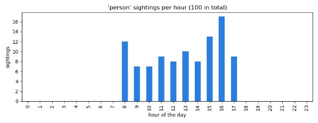

# Day 9: Memory with SQL

**Hours 25-27 of 45** · **Milestone 5:** the event memory (`intelligence/events.py`) and a pretend history to learn from

## What you can do at the end of today

- Explain what a database, a table, a row and a column are.
- Write SQL with `CREATE TABLE`, `INSERT`, `SELECT`, `WHERE`, `ORDER BY`, `LIMIT` and `GROUP BY`.
- Use Python's `sqlite3` safely, with `?` placeholders.
- Write the `EventStore` class: the memory of the Intelligence System.
- Fill a database with pretend history, and chart it with pandas and matplotlib.

## Where today fits in the project

A camera that forgets everything is not intelligent. The system must remember **what it saw and when**: "a person appeared at 08:15", "an alert was sent at 23:10", "the person left after 12 seconds". Memory also gives the system a way to be surprised: if people normally show up between 8 and 18 o'clock, a person at 3 a.m. is **unusual**. That rule (Day 14) needs history to compare with.

The memory is a **SQLite** database: one file on disk (`data/events.db`), no server, and it is already part of Python.

## Plan for the day

| Hour | Minutes | Activity |
|---|---|---|
| 25 | 5 | Warm-up: commit check, `git log --oneline` |
| | 20 | Talk: databases, tables, SQL |
| | 10 | Live demo with the practice database |
| | 25 | **Labs 9.1-9.3** Practice queries |
| 26 | 15 | Talk: `sqlite3` in Python, placeholders, the events table |
| | 10 | Live demo (including a SQL injection) |
| | 35 | **Lab 9.4 (Milestone 5)** `EventStore` |
| 27 | 15 | Talk: pretend history, `random`, pandas, matplotlib |
| | 10 | Live demo |
| | 35 | **Labs 9.5-9.7** Seed, query and chart the history |

---

# Hour 25: Databases and SQL

## Learn

A **database** stores data on disk in an organised way, so it is still there when the program stops. It answers questions fast ("how many persons came on Monday?") and it stays correct if the program crashes in the middle of a write.

Our database is **SQLite**: the whole database is **one file**. There is no server to install. Python includes it in the module `sqlite3`.

A database is made of **tables**. A table is like a spreadsheet:

- A **column** has a name and a type (`TEXT`, `INTEGER`, `REAL` for decimals).
- A **row** is one record.
- A **primary key** is a column whose value is different in every row (here `id`, which counts up by itself).

**SQL** (say "sequel") is the language used to talk to databases. The main commands:

| Command | What it does |
|---|---|
| `CREATE TABLE` | makes a table |
| `INSERT INTO table (columns) VALUES (values)` | adds a row |
| `SELECT columns FROM table` | reads rows |
| `WHERE condition` | keeps only rows that match |
| `ORDER BY column [DESC]` | sorts (`DESC` = biggest first) |
| `LIMIT n` | keeps the first n rows |
| `GROUP BY column` | makes one result row per value of the column |
| `COUNT(*)`, `AVG(x)`, `SUM(x)`, `MIN(x)`, `MAX(x)` | calculate over a group |
| `UPDATE`, `DELETE` | change or remove rows. Always use `WHERE`, or you change **every** row! |

SQL keywords are not case sensitive, but it is a habit to write them in capitals.

**Dates in SQLite** are stored as text in the **ISO 8601** format: `2026-03-12T08:15:00`. Text in this format sorts in time order, and you can compare it with `>=`. The function `strftime('%H', ts)` takes the hour out of it (as text, so we wrap it in `CAST(... AS INTEGER)` to get a number).

## Lab 9.1: The practice database

Create `exercises/day09/make_practice_db.py`. It makes a small table `sightings` with 14 rows, so you can practise queries on something real. (This is the first time we write `CREATE TABLE` and `INSERT`: read how it works.)

**`exercises/day09/make_practice_db.py`**

```python
import sqlite3
from pathlib import Path

Path("data").mkdir(exist_ok=True)
Path("data/practice.db").unlink(missing_ok=True)  # start fresh every time

db = sqlite3.connect("data/practice.db")
db.execute(
    """
    CREATE TABLE sightings (
        id         INTEGER PRIMARY KEY AUTOINCREMENT,
        ts         TEXT NOT NULL,
        label      TEXT NOT NULL,
        confidence REAL
    )
    """
)

rows = [
    ("2026-03-12T08:15:00", "person", 0.91),
    ("2026-03-12T08:40:00", "car", 0.84),
    ("2026-03-12T12:05:00", "person", 0.77),
    ("2026-03-12T12:07:00", "person", 0.88),
    ("2026-03-12T18:30:00", "dog", 0.69),
    ("2026-03-12T23:10:00", "person", 0.62),
    ("2026-03-13T02:45:00", "person", 0.55),
    ("2026-03-13T08:20:00", "bicycle", 0.73),
    ("2026-03-13T08:22:00", "person", 0.93),
    ("2026-03-13T14:00:00", "car", 0.81),
    ("2026-03-13T17:50:00", "person", 0.86),
    ("2026-03-14T08:10:00", "person", 0.95),
    ("2026-03-14T12:30:00", "cat", 0.58),
    ("2026-03-14T21:15:00", "person", 0.79),
]
db.executemany("INSERT INTO sightings (ts, label, confidence) VALUES (?, ?, ?)", rows)
db.commit()
db.close()
print(f"Created data/practice.db with {len(rows)} sightings")
```

```text
$ python exercises/day09/make_practice_db.py
Created data/practice.db with 14 sightings
```

The folder `data` is in your `.gitignore`, so database files are never committed.

## Lab 9.2: A tool to run SQL

You need a way to type a query and see the answer. Copy this small helper into `tools/run_sql.py` and create an empty file `tools/__init__.py` next to it (like `tests/__init__.py`). You do not need to understand every line today: it runs one SQL statement and prints a table.

**`tools/run_sql.py`**

```python
"""Run one SQL statement on a SQLite file and print the result as a table.

    python -m tools.run_sql data/practice.db "SELECT * FROM sightings LIMIT 5"
"""
import sqlite3
import sys
from pathlib import Path


def main():
    if len(sys.argv) != 3:
        raise SystemExit('Usage: python -m tools.run_sql data/events.db "SELECT * FROM events LIMIT 5"')
    database, query = sys.argv[1], sys.argv[2]
    if not Path(database).is_file():
        raise SystemExit(f"Database file not found: {database}")

    db = sqlite3.connect(database)
    cursor = db.execute(query)
    if cursor.description is None:  # INSERT, UPDATE, DELETE ... have no table to show
        db.commit()
        print("OK")
        return

    names = [column[0] for column in cursor.description]
    rows = cursor.fetchall()
    widths = [max(len(str(value)) for value in [name] + [row[i] for row in rows]) for i, name in enumerate(names)]
    print("  ".join(name.ljust(width) for name, width in zip(names, widths)))
    print("  ".join("-" * width for width in widths))
    for row in rows:
        print("  ".join(str(value).ljust(width) for value, width in zip(row, widths)))
    print(f"({len(rows)} rows)")


if __name__ == "__main__":
    main()
```

Try it. You run a module in the `tools` package with `python -m`:

```text
$ python -m tools.run_sql data/practice.db "SELECT * FROM sightings LIMIT 5"
id  ts                   label   confidence
--  -------------------  ------  ----------
1   2026-03-12T08:15:00  person  0.91      
2   2026-03-12T08:40:00  car     0.84      
3   2026-03-12T12:05:00  person  0.77      
4   2026-03-12T12:07:00  person  0.88      
5   2026-03-12T18:30:00  dog     0.69      
(5 rows)
```

(You can also use a free viewer such as "DB Browser for SQLite" or the VS Code extension "SQLite Viewer". The helper works everywhere without installing anything.)

## Lab 9.3: Ask questions

Answer each question with a query. Try before you open the answers. Always put the SQL in quotes.

1. Show only the persons.
2. Show persons with confidence at least `0.8`, the most confident first.
3. How many sightings are there of each label? The most frequent first.
4. What is the average confidence of each label?
5. How many sightings are there in each hour of the day?
6. Show the 3 newest sightings.
7. Show the sightings at night (22:00 to 05:59).

<details><summary>Answers</summary>

1. Persons:

```text
$ python -m tools.run_sql data/practice.db "SELECT * FROM sightings WHERE label = 'person'"
id  ts                   label   confidence
--  -------------------  ------  ----------
1   2026-03-12T08:15:00  person  0.91      
3   2026-03-12T12:05:00  person  0.77      
4   2026-03-12T12:07:00  person  0.88      
6   2026-03-12T23:10:00  person  0.62      
7   2026-03-13T02:45:00  person  0.55      
9   2026-03-13T08:22:00  person  0.93      
11  2026-03-13T17:50:00  person  0.86      
12  2026-03-14T08:10:00  person  0.95      
14  2026-03-14T21:15:00  person  0.79      
(9 rows)
```

2. Strong persons, best first:

```text
$ python -m tools.run_sql data/practice.db "SELECT id, ts, confidence FROM sightings WHERE label = 'person' AND confidence >= 0.8 ORDER BY confidence DESC"
id  ts                   confidence
--  -------------------  ----------
12  2026-03-14T08:10:00  0.95      
9   2026-03-13T08:22:00  0.93      
1   2026-03-12T08:15:00  0.91      
4   2026-03-12T12:07:00  0.88      
11  2026-03-13T17:50:00  0.86      
(5 rows)
```

3. Count per label:

```text
$ python -m tools.run_sql data/practice.db "SELECT label, COUNT(*) AS n FROM sightings GROUP BY label ORDER BY n DESC"
label    n
-------  -
person   9
car      2
dog      1
cat      1
bicycle  1
(5 rows)
```

4. Average confidence per label:

```text
$ python -m tools.run_sql data/practice.db "SELECT label, ROUND(AVG(confidence), 2) AS average FROM sightings GROUP BY label"
label    average
-------  -------
bicycle  0.73   
car      0.82   
cat      0.58   
dog      0.69   
person   0.81   
(5 rows)
```

5. Sightings per hour:

```text
$ python -m tools.run_sql data/practice.db "SELECT CAST(strftime('%H', ts) AS INTEGER) AS hour, COUNT(*) AS n FROM sightings GROUP BY hour ORDER BY hour"
hour  n
----  -
2     1
8     5
12    3
14    1
17    1
18    1
21    1
23    1
(8 rows)
```

6. The newest three:

```text
$ python -m tools.run_sql data/practice.db "SELECT * FROM sightings ORDER BY ts DESC LIMIT 3"
id  ts                   label   confidence
--  -------------------  ------  ----------
14  2026-03-14T21:15:00  person  0.79      
13  2026-03-14T12:30:00  cat     0.58      
12  2026-03-14T08:10:00  person  0.95      
(3 rows)
```

7. At night. The hour must be 22 or more, **or** below 6 (the same `or` as on Day 2):

```text
$ python -m tools.run_sql data/practice.db "SELECT * FROM sightings WHERE CAST(strftime('%H', ts) AS INTEGER) >= 22 OR CAST(strftime('%H', ts) AS INTEGER) < 6"
id  ts                   label   confidence
--  -------------------  ------  ----------
6   2026-03-12T23:10:00  person  0.62      
7   2026-03-13T02:45:00  person  0.55      
(2 rows)
```

</details>

Look at question 5. The two night sightings (hours 2 and 23) are lonely: most sightings are between 8 and 18. **This is the idea behind "unusual for this hour"** that you build on Day 14.

## Check yourself

1. What is the difference between `WHERE` and `GROUP BY`?
2. Why do ISO dates (`2026-03-12T08:15:00`) work well as text?
3. What happens if you run `DELETE FROM sightings` without `WHERE`?

<details><summary>Answers</summary>

1. `WHERE` keeps or drops single rows. `GROUP BY` combines rows that have the same value into one result row (usually with `COUNT`, `AVG`, ...).
2. The biggest unit comes first (year, month, day, hour...), so sorting the text sorts the time, and you can compare with `>=` and `<`.
3. Every row is deleted.

</details>

---

# Hour 26: `sqlite3` in Python and the `EventStore` (Milestone 5)

## Learn

The steps in Python:

1. `db = sqlite3.connect(path)` opens (or creates) the database file.
2. `db.execute("SQL", parameters)` runs one statement and returns a **cursor**.
3. `cursor.fetchall()` gives a list of rows. Each row is a **tuple**.
4. After changing data (`INSERT`, `UPDATE`, `DELETE`) call `db.commit()` to save it for real.
5. `db.close()` when you are done.

Try it with a database that lives only in memory (`":memory:"`):

```pycon
>>> import sqlite3
>>> db = sqlite3.connect(":memory:")
>>> db.execute("CREATE TABLE people (name TEXT, age INTEGER)")
<sqlite3.Cursor object at 0x171bacbc0>
>>> db.execute("INSERT INTO people VALUES (?, ?)", ("Sokha", 20))
<sqlite3.Cursor object at 0x171baccc0>
>>> db.execute("INSERT INTO people VALUES (?, ?)", ("Dara", 25))
<sqlite3.Cursor object at 0x171bacd40>
>>> db.commit()
>>> db.execute("SELECT * FROM people").fetchall()
[('Sokha', 20), ('Dara', 25)]
>>> db.execute("SELECT name FROM people WHERE age > ?", (21,)).fetchall()
[('Dara',)]
>>> cursor = db.execute("INSERT INTO people VALUES (?, ?)", ("Vanna", 31))
>>> cursor.lastrowid
3
```

### Always use `?` placeholders

Never put values into SQL text with an f-string. Use `?` and pass the values as a tuple. If you do not, a user can type SQL **instead of a name** and take control of your database. This attack is called **SQL injection**, and it is one of the most common security bugs in the world:

```pycon
>>> import sqlite3
>>> db = sqlite3.connect(":memory:")
>>> db.execute("CREATE TABLE people (name TEXT)")
<sqlite3.Cursor object at 0x171b77dc0>
>>> db.execute("INSERT INTO people VALUES (?)", ("Sokha",))
<sqlite3.Cursor object at 0x171bacbc0>
>>> db.execute("INSERT INTO people VALUES (?)", ("Dara",))
<sqlite3.Cursor object at 0x171b77dc0>
>>> name = "x' OR '1'='1"
>>> bad = f"SELECT name FROM people WHERE name = '{name}'"
>>> bad
"SELECT name FROM people WHERE name = 'x' OR '1'='1'"
>>> db.execute(bad).fetchall()
[('Sokha',), ('Dara',)]
>>> db.execute("SELECT name FROM people WHERE name = ?", (name,)).fetchall()
[]
```

The f-string version turned the "name" into `... WHERE name = 'x' OR '1'='1'`, which is true for every row, so it returned **everybody**. The `?` version treats the whole text as one value and finds nobody. Placeholders also handle quotes and special characters for you. Our project's events (labels, zone names) will be text, so we always use `?`.

### The events table

The `EventStore` keeps one table, `events`. Every important moment is one row:

| Column | Meaning |
|---|---|
| `id` | counts up by itself |
| `ts` | when it happened (ISO text) |
| `kind` | what happened: `appeared`, `zone_enter`, `alert` or `left` |
| `track_id`, `label` | which object (the tracker's id, and "person", "car"...) |
| `zone` | the zone it entered, if any |
| `severity` | 0-3, how serious (Day 14) |
| `alerted` | 1 if an alert was sent |
| `snapshot` | the photo file of the alert |
| `detail` | free text, e.g. "person, at night, in front_door" |

The program (Day 15) will write one row each time a track appears, enters a zone, causes an alert, or leaves.

## Lab 9.4 (Milestone 5): Write `EventStore`

Create `intelligence/events.py`:

**`intelligence/events.py`**

```python
import sqlite3
from datetime import datetime

SCHEMA = """
CREATE TABLE IF NOT EXISTS events (
    id        INTEGER PRIMARY KEY AUTOINCREMENT,
    ts        TEXT    NOT NULL,   -- local time, ISO 8601
    kind      TEXT    NOT NULL,   -- appeared | zone_enter | alert | left
    track_id  INTEGER,
    label     TEXT,
    zone      TEXT,
    severity  INTEGER NOT NULL DEFAULT 0,
    alerted   INTEGER NOT NULL DEFAULT 0,
    snapshot  TEXT,
    detail    TEXT
);
CREATE INDEX IF NOT EXISTS idx_events_ts ON events (ts);
CREATE INDEX IF NOT EXISTS idx_events_label_kind ON events (label, kind);
"""


class EventStore:
    """The system's memory: everything it has seen, in a local SQLite file."""

    def __init__(self, path):
        path.parent.mkdir(parents=True, exist_ok=True)
        self.db = sqlite3.connect(path)
        self.db.executescript(SCHEMA)
        self.db.commit()

    def add(self, kind, track_id=None, label=None, zone=None, severity=0,
            alerted=False, snapshot=None, detail=None, ts=None):
        ts = (ts or datetime.now()).isoformat(timespec="seconds")
        cur = self.db.execute(
            "INSERT INTO events (ts, kind, track_id, label, zone, severity, alerted, snapshot, detail) "
            "VALUES (?, ?, ?, ?, ?, ?, ?, ?, ?)",
            (ts, kind, track_id, label, zone, severity, int(alerted), snapshot, detail),
        )
        self.db.commit()
        return cur.lastrowid

    def recent(self, limit=20):
        return self.db.execute(
            "SELECT ts, kind, label, track_id, zone, severity, alerted, detail "
            "FROM events ORDER BY id DESC LIMIT ?",
            (limit,),
        ).fetchall()

    def today_summary(self):
        today = datetime.now().strftime("%Y-%m-%d")
        return self.db.execute(
            "SELECT label, SUM(kind = 'appeared'), SUM(kind = 'alert') FROM events "
            "WHERE kind IN ('appeared', 'alert') AND ts >= ? GROUP BY label ORDER BY 2 DESC",
            (today,),
        ).fetchall()

    def close(self):
        self.db.close()
```

Walk through it:

- **`SCHEMA`** is SQL text. `CREATE TABLE IF NOT EXISTS` makes the table only when it is missing, so the program can start many times. The two `CREATE INDEX` lines make searches by `ts` and by `label` + `kind` fast (like the index of a book). `--` starts a comment in SQL.
- **`__init__`** creates the folder if needed (`mkdir(parents=True, exist_ok=True)`), opens the database and runs the schema with `executescript` (for several statements).
- **`add`** saves one event. Most arguments have default values, so you only pass what you know. If you give no time, it uses now, as ISO text. `int(alerted)` turns `True`/`False` into `1`/`0`. It uses nine `?` placeholders, commits, and returns the new row number.
- **`recent`** returns the newest rows first (`ORDER BY id DESC LIMIT ?`).
- **`today_summary`** counts, for each label, how many times it appeared and how many alerts it caused today. `SUM(kind = 'appeared')` works because SQLite gives `1` for true and `0` for false, so adding them counts the true ones. `ts >= ?` with today's date compares ISO text.
- **`close`** closes the file.

Now check it. `tests/check_events.py` writes to a temporary database (deleted afterwards, so your real memory is not touched) and checks every method:

**`tests/check_events.py`**

```python
import tempfile
from datetime import datetime, timedelta
from pathlib import Path

from intelligence.events import EventStore

with tempfile.TemporaryDirectory() as folder:
    store = EventStore(Path(folder) / "sub" / "events.db")  # also creates the folder "sub"

    store.add("appeared", track_id=1, label="person", severity=2, detail="person")
    store.add("zone_enter", track_id=1, label="person", zone="front_door", severity=3)
    store.add("alert", track_id=1, label="person", severity=3, alerted=True, snapshot="a.jpg")
    store.add("appeared", track_id=2, label="car", severity=1)
    store.add("left", track_id=1, label="person", severity=3, detail="seen 12s")

    rows = store.recent(3)
    assert len(rows) == 3
    assert rows[0][1] == "left"  # newest first
    assert rows[0][7] == "seen 12s"

    summary = store.today_summary()
    assert ("person", 1, 1) in summary  # 1 appeared, 1 alert
    assert ("car", 1, 0) in summary

    # An event from yesterday is not in today's summary
    store.add("appeared", track_id=3, label="dog", severity=0, ts=datetime.now() - timedelta(days=1))
    assert not any(label == "dog" for label, _, _ in store.today_summary())

    store.close()

print("events OK")
```

```text
$ python -m tests.check_events
events OK
```

If an `assert` fails, read which one: it tells you which method is wrong.

## Check yourself

1. Why do we call `db.commit()` after an `INSERT`?
2. What is wrong with `db.execute(f"SELECT * FROM people WHERE name = '{name}'")`?
3. What does `EventStore.add(...)` return?

<details><summary>Answers</summary>

1. Until you commit, the change is not saved permanently. If the program stopped, it would be lost.
2. The value goes into the SQL text, so a user can write SQL in `name` (SQL injection). Use `?` and pass `(name,)`.
3. The `id` of the new row (`cur.lastrowid`).

</details>

---

# Hour 27: Pretend history, pandas and a chart

## Learn

On Day 14 the system will ask: "is this hour a normal hour for a person to appear?" It answers by looking at the **history** in the database. A new database is empty, and a classroom cannot wait 30 days to collect history. So you will create **pretend history**: sightings spread over the last 20 days, all during the day.

**Making random data.** The `random` module gives random numbers. `random.randint(8, 17)` is a whole number from 8 to 17, **including both ends**. `random.seed(1)` makes the "random" numbers repeat in the same order every time, which makes results reproducible:

```pycon
>>> import random
>>> random.seed(1)
>>> [random.randint(8, 17) for _ in range(5)]
[10, 17, 9, 12, 9]
>>> random.seed(1)
>>> [random.randint(8, 17) for _ in range(5)]
[10, 17, 9, 12, 9]
```

`for _ in range(5)` means "repeat 5 times and I do not need the counter". (`_` is a normal variable name that says "I do not use this".)

**pandas** is a library for tables of data. A `DataFrame` is a table. It can read the result of a SQL query straight into a table (`pd.read_sql`), and group, count and plot it:

```pycon
>>> import pandas as pd
>>> df = pd.DataFrame({"hour": [9, 10, 10, 14], "label": ["person", "car", "person", "person"]})
>>> df
   hour   label
0     9  person
1    10     car
2    10  person
3    14  person
>>> df.shape
(4, 2)
>>> df["label"].value_counts()
label
person    3
car       1
Name: count, dtype: int64
>>> df[df["label"] == "person"]
   hour   label
0     9  person
2    10  person
3    14  person
>>> df.groupby("hour").size()
hour
9     1
10    2
14    1
dtype: int64
```

**matplotlib** draws charts. `table.plot.bar()` makes a bar chart. On a computer with no screen we tell matplotlib to draw into a **file** (`matplotlib.use("Agg")`).

## Lab 9.5: Make the pretend history

Create `tools/seed_history.py`. For each of the last 20 days, it adds 5 sightings of a person at a random time between 08:00 and 17:59, by calling your own `EventStore.add(...)`. Notice that it gives `add` an explicit `ts` (time), which is why that parameter exists. It writes to a **separate** file, `data/demo_events.db`, and refuses to overwrite a file that already exists (unless you add `--replace`), so you can never destroy your real history by accident.

**`tools/seed_history.py`**

```python
"""Fill a database with PRETEND daytime sightings, so the "unusual for this hour" rule can be tested.

    python -m tools.seed_history                    -> data/demo_events.db (20 days, 5 sightings a day)
    python -m tools.seed_history --days 30 --per-day 8 --replace
"""
import argparse
import random
from datetime import datetime, timedelta

from intelligence.config import project_path
from intelligence.events import EventStore


def main():
    ap = argparse.ArgumentParser(description="Fill a database with pretend daytime sightings")
    ap.add_argument("--db", default="data/demo_events.db", help="database file to create")
    ap.add_argument("--days", type=int, default=20, help="how many past days to fill")
    ap.add_argument("--per-day", type=int, default=5, help="sightings per day")
    ap.add_argument("--label", default="person")
    ap.add_argument("--first-hour", type=int, default=8)
    ap.add_argument("--last-hour", type=int, default=17)
    ap.add_argument("--seed", type=int, default=1, help="same seed = same pretend history")
    ap.add_argument("--replace", action="store_true", help="delete the file first if it exists")
    args = ap.parse_args()

    path = project_path(args.db)
    if path.exists():
        if not args.replace:
            raise SystemExit(f"{path} already exists. Use --replace to delete it first.")
        path.unlink()

    random.seed(args.seed)
    store = EventStore(path)
    now = datetime.now()
    count = 0
    for days_ago in range(1, args.days + 1):
        for _ in range(args.per_day):
            when = (now - timedelta(days=days_ago)).replace(
                hour=random.randint(args.first_hour, args.last_hour),
                minute=random.randint(0, 59),
                second=0,
                microsecond=0,
            )
            count += 1
            store.add("appeared", track_id=count, label=args.label, severity=2, ts=when)
    store.close()
    print(f"Saved {count} pretend '{args.label}' sightings between {args.first_hour}:00 and "
          f"{args.last_hour}:59 to {path}")


if __name__ == "__main__":
    main()
```

```text
$ python -m tools.seed_history
Saved 100 pretend 'person' sightings between 8:00 and 17:59 to /path/to/my-intelligence-system/data/demo_events.db
```

If you run it a second time, it protects the file:

```text
$ python -m tools.seed_history
/path/to/my-intelligence-system/data/demo_events.db already exists. Use --replace to delete it first.
```

Check what is in the new database with your SQL helper (the dates in your database are the days before **today**, so they will look different from other people's):

```text
$ python -m tools.run_sql data/demo_events.db "SELECT kind, label, COUNT(*) AS n, MIN(severity) AS severity FROM events GROUP BY kind, label"
kind      label   n    severity
--------  ------  ---  --------
appeared  person  100  2       
(1 rows)
```

## Lab 9.6: Chart the history

Copy `tools/plot_hours.py`. It reads the database into a pandas table with the SQL query from hour 25 (this time with a `?` placeholder for the label), fills in the missing hours with zero (`reindex`), and saves a bar chart.

**`tools/plot_hours.py`**

```python
"""Chart: how many sightings in each hour of the day.

    python -m tools.plot_hours data/demo_events.db
"""
import argparse
import sqlite3

import matplotlib

matplotlib.use("Agg")  # draw into a file: no window needed
import matplotlib.pyplot as plt
import pandas as pd

from intelligence.config import project_path


def main():
    ap = argparse.ArgumentParser(description="Chart of sightings per hour of the day")
    ap.add_argument("db", nargs="?", default="data/demo_events.db", help="database file")
    ap.add_argument("--label", default="person")
    ap.add_argument("--out", default="output/sightings_per_hour.png")
    args = ap.parse_args()

    path = project_path(args.db)
    if not path.is_file():
        raise SystemExit(f"Database file not found: {path}")

    db = sqlite3.connect(path)
    query = (
        "SELECT CAST(strftime('%H', ts) AS INTEGER) AS hour, COUNT(*) AS sightings "
        "FROM events WHERE kind = 'appeared' AND label = ? GROUP BY hour"
    )
    table = pd.read_sql(query, db, params=(args.label,))
    db.close()
    if table.empty:
        raise SystemExit(f"No 'appeared' events for label {args.label!r} in {path}")

    per_hour = table.set_index("hour")["sightings"].reindex(range(24), fill_value=0)

    ax = per_hour.plot.bar(color="#2a7de1", figsize=(9, 3.5))
    ax.set_xlabel("hour of the day")
    ax.set_ylabel("sightings")
    ax.set_title(f"'{args.label}' sightings per hour ({per_hour.sum()} in total)")
    plt.tight_layout()

    out = project_path(args.out)
    out.parent.mkdir(parents=True, exist_ok=True)
    plt.savefig(out, dpi=100)

    quiet = [hour for hour in range(24) if per_hour[hour] == 0]
    print(f"{per_hour.sum()} sightings. Busiest hour: {per_hour.idxmax()}:00 ({per_hour.max()} sightings)")
    print("Hours with no sightings:", quiet)
    print("Chart saved to", out)


if __name__ == "__main__":
    main()
```

```text
$ python -m tools.plot_hours data/demo_events.db
100 sightings. Busiest hour: 16:00 (17 sightings)
Hours with no sightings: [0, 1, 2, 3, 4, 5, 6, 7, 18, 19, 20, 21, 22, 23]
Chart saved to /path/to/my-intelligence-system/output/sightings_per_hour.png
```

Open `output/sightings_per_hour.png`:



## Lab 9.7: Think

Look at your chart and answer:

1. Which hours have **no** sightings at all?
2. If a person is detected at 03:00, how surprising is that, compared with this history?
3. If a person is detected at 12:00, how surprising is it?
4. Why does the rule need a **minimum amount** of history before it judges anything?

<details><summary>Answers</summary>

1. 0 to 7 and 18 to 23: all of the night and early morning, and the evening.
2. Very surprising: no sighting in the whole history happened at 03:00 (the share of sightings at that hour is 0%).
3. Not surprising: many sightings happened around noon.
4. With only 3 sightings, "9 o'clock has 33% of them" means nothing: the sample is too small. The rule on Day 14 waits for at least 30 sightings (`min_history` in `config.json`) before it says anything. The same reason is why this lab creates 100 sightings.

</details>

The rule you will build on Day 14, in one sentence: *"For this label and this hour, take the share of all past sightings that happened in this hour. If the share is below 2% (`rare_share`), the sighting is unusual."*

## Check yourself (exit ticket)

1. What does `random.seed(1)` do?
2. Which `pandas` function reads a SQL query into a table?
3. Why does `seed_history.py` write to `demo_events.db` and not `events.db`?

<details><summary>Answers</summary>

1. It starts the random numbers from the same point, so you get the same "random" numbers every time.
2. `pd.read_sql(query, connection)`.
3. The pretend history must never mix with your real sightings. The real database stays honest, and you can delete the demo one at any time.

</details>

## Homework (optional, 20 minutes)

Write a SQL query that shows, for `data/demo_events.db`, the number of sightings per **day** (`date(ts)`). How many days have exactly 5 sightings? (Hint: `SELECT date(ts) AS day, COUNT(*) FROM events GROUP BY day`.)

---

# Day 9 wrap-up

## Checklist

- [ ] `python -m tests.check_events` prints `events OK`.
- [ ] You ran the 7 practice queries.
- [ ] `data/demo_events.db` exists and has 100 rows.
- [ ] `output/sightings_per_hour.png` shows bars only between 8 and 17.
- [ ] You can explain why we use `?` and not f-strings in SQL.
- [ ] You committed (`git commit -m "Day 9: events memory and pretend history"`).

## Your project folder today

```text
my-intelligence-system/
├── data/                       <- created today (ignored by git)
│   ├── practice.db
│   └── demo_events.db
├── intelligence/
│   ├── events.py               <- new: EventStore
│   └── ...
├── tools/                      <- new folder
│   ├── __init__.py
│   ├── run_sql.py
│   ├── seed_history.py
│   └── plot_hours.py
├── tests/
│   └── check_events.py         <- new
└── exercises/day09/
    └── make_practice_db.py
```

Solutions are in [`solutions/day09/`](solutions/day09/).

## Instructor notes

- **SQL is a second language.** Do not move on until every student has typed at least three queries themselves. Let them break things: a typo in a column name gives a clear error.
- **Injection demo:** run the f-string example live and let students see "everybody" come back. It is the most memorable security lesson in the course.
- **`GROUP BY`** is the hardest idea. Draw the table on the board, circle the rows with the same label, and show that each circle becomes one result row.
- **Windows:** the temp-folder test closes the database before leaving the `with` block, so Windows can delete the file. If a student sees `PermissionError` there, they forgot `store.close()`.
- **Dates in the demo database are relative to today.** Students will see different dates from the lesson text. That is expected; only the hours matter.
- **If you are behind:** run Lab 9.3 as a demo (write 3 queries together) and spend the saved time on Milestone 5. Do not skip Lab 9.5: Day 14 needs the demo database.
- **Fast finishers:** add a method `count_since(label, minutes)` that counts events of one label in the last N minutes, using `timedelta` and a `WHERE ts >= ?` query.
