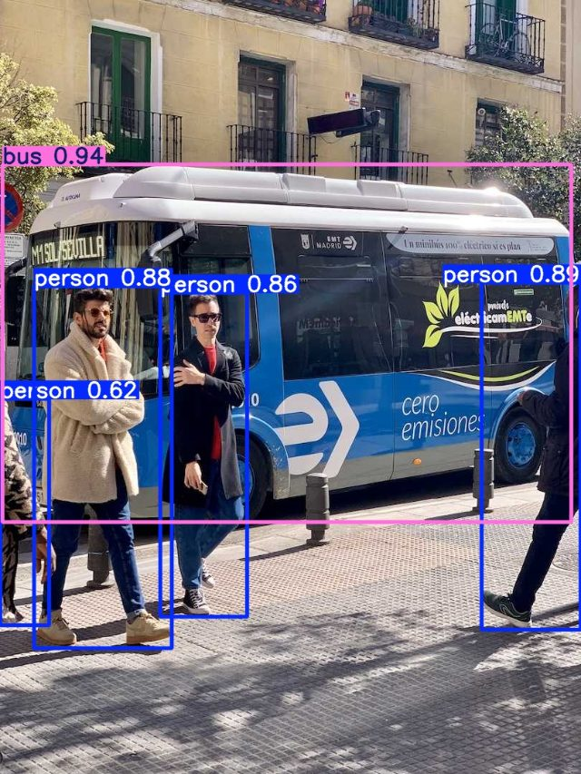

# Day 12: Object detection with YOLO

**Hours 34-36 of 45** · Milestone: you run a neural network on pictures and video, and you set up the project's detector settings

## What you can do at the end of today

- Explain in plain words what machine learning, a neural network and object detection are.
- Read a detection: box, class, confidence. Explain the confidence threshold and its trade-off.
- Explain IoU and non-maximum suppression (NMS), and write IoU in Python.
- Use PyTorch tensors, and choose the best device (CPU, NVIDIA GPU, Apple GPU).
- Run YOLO on images and on a video, read its results, and compare two model sizes.

## Where today fits in the project

Until now the camera could only say "something moved". Today a neural network says **what** is in the picture and **where**: "person, 89% sure, at these pixels". This is the AI of the Intelligence System. You do not train it: you use a **pretrained** model that has already learned from millions of labelled pictures.

```text
frame ─► [ YOLO ] ─► list of (box, class, confidence)  ─►  (tracking: Day 13)  ─►  (rules: Day 14)
```

## Plan for the day

| Hour | Minutes | Activity |
|---|---|---|
| 34 | 5 | Warm-up: name two things motion detection cannot tell you |
| | 25 | Talk: machine learning, detection, confidence, IoU, NMS |
| | 30 | **Lab 12.1** IoU and NMS in Python |
| 35 | 20 | Talk: PyTorch tensors and devices |
| | 10 | Live demo |
| | 30 | **Lab 12.2** Tensors and a GPU speed test |
| 36 | 10 | Talk: the `ultralytics` library |
| | 50 | **Labs 12.3-12.7** YOLO on images, thresholds, model sizes, video, project settings |

---

# Hour 34: What is object detection?

## Learn

### Machine learning in plain words

In normal programming **you** write the rules: *"if hour >= 22 then it is night"*. Some problems have rules nobody can write. What rule says "this group of pixels is a person"? Think of different clothes, light, angles, and people who are partly hidden.

**Machine learning** turns the problem around. You give the computer **many examples with the right answers** (millions of pictures where people drew a box around every person). A program called a **neural network** adjusts millions of numbers (**weights**) until it gives the right answers on the examples. This is **training**. After training you use the network on new pictures. This is **inference**, and it is what we do in this course.

```text
 normal program:    rules + data    →  answers
 machine learning:  data + answers  →  rules  (the "model", a file of numbers)
```

The model file you will use is `yolo11n.pt` (about 5.6 MB). It contains the numbers that Ultralytics learned from the **COCO** dataset, a famous collection of hundreds of thousands of labelled pictures with **80 kinds of objects** (person, bicycle, car, dog, cat, bus, chair, cell phone, ...).

### Classification, detection, segmentation

| Task | Question it answers | Output |
|---|---|---|
| Classification | What is in this picture? | one label ("cat") |
| **Detection** | **What is here, and where?** | **a box, a label and a confidence for every object** |
| Segmentation | Which exact pixels belong to each object? | a mask per object |

A security camera needs to know **where** the person is (for zones, for following them). So we use **detection**.

**YOLO** means "You Only Look Once": the network looks at the picture one time and gives all boxes at once, which is why it is fast enough for video.

### What a detection is

For every object found, the detector gives:

- **box** `(x1, y1, x2, y2)` in pixels (you know this format from Day 7);
- **class**, a number which maps to a name: `0` is `person`, `2` is `car`;
- **confidence**, a number from 0 to 1: how sure the network is.

### The confidence threshold

A detector always finds *candidates*, some of them wrong. You choose a **threshold**: boxes with a confidence below it are thrown away.

| Low threshold (0.10) | High threshold (0.90) |
|---|---|
| finds almost everything | finds only what it is sure about |
| many **false alarms** (a shadow is a "person") | many **misses** (a real person is dropped) |

For a security camera both mistakes are bad: a miss means a person was not noticed, a false alarm means a useless message at 3 a.m. The project uses `0.45` (the `confidence` setting in `config.json`) and then uses **rules** (Day 14) to decide what is worth an alert. You will see the effect of the threshold in Lab 12.4.

### IoU and NMS

A network often finds the **same object several times**: many slightly different boxes around one person. To clean this up, detectors use **non-maximum suppression (NMS)**:

1. Sort the boxes by confidence, best first.
2. Keep the best box.
3. Remove every other box that **overlaps it too much**.
4. Repeat with the best box that is left.

"Overlaps too much" is measured by **IoU** (**I**ntersection **o**ver **U**nion):

```text
            area where the two boxes overlap
   IoU  =  ─────────────────────────────────────
            area covered by at least one of them
```

IoU is `0` for boxes that do not touch and `1` for identical boxes. Two boxes of the same size that overlap by half have IoU = 50 / (100 + 100 - 50) = **1/3**.

(Remember the warning you may have seen on a Mac: `torchvision::nms is not currently supported on the MPS backend`. NMS is exactly this step. The warning only says that this one step will run on the CPU.)

IoU will come back on Day 13: the tracker uses it to decide that "this box in frame 12 is the same person as that box in frame 11".

## Lab 12.1: IoU and NMS in Python

Write `iou(a, b)` and a small `nms` function. This is all plain Python from Days 2 and 3: functions, tuples, `max`, `min`, `sorted` with a `key`, and `all(...)`. Create `exercises/day12/iou.py`:

**`exercises/day12/iou.py`**

```python
def box_area(box):
    x1, y1, x2, y2 = box
    return max(0, x2 - x1) * max(0, y2 - y1)


def iou(a, b):
    """Intersection over Union: 0 = the boxes do not touch, 1 = identical boxes."""
    overlap = (max(a[0], b[0]), max(a[1], b[1]), min(a[2], b[2]), min(a[3], b[3]))
    intersection = box_area(overlap)
    union = box_area(a) + box_area(b) - intersection
    return intersection / union if union else 0.0


def nms(detections, threshold=0.5):
    """Non-maximum suppression: keep the best box, drop boxes that overlap a kept box too much."""
    keep = []
    for detection in sorted(detections, key=lambda d: d[1], reverse=True):
        if all(iou(detection[2], kept[2]) < threshold for kept in keep):
            keep.append(detection)
    return keep


assert iou((0, 0, 10, 10), (0, 0, 10, 10)) == 1.0  # the same box
assert iou((0, 0, 10, 10), (20, 20, 30, 30)) == 0.0  # far apart
assert abs(iou((0, 0, 10, 10), (5, 0, 15, 10)) - 1 / 3) < 1e-9  # half overlap: 50 / (100 + 100 - 50)

detections = [
    ("person", 0.90, (100, 100, 200, 300)),
    ("person", 0.85, (105, 98, 205, 305)),  # the same person, found a second time
    ("person", 0.80, (400, 120, 480, 320)),  # a different person
]
print("IoU of the two boxes on the first person:", round(iou(detections[0][2], detections[1][2]), 2))
print("IoU of person 1 and person 2:", round(iou(detections[0][2], detections[2][2]), 2))

kept = nms(detections)
print("kept", len(kept), "of", len(detections), "boxes:")
for label, confidence, box in kept:
    print(f"  {label} {confidence:.2f} {box}")
```

```text
$ python exercises/day12/iou.py
IoU of the two boxes on the first person: 0.88
IoU of person 1 and person 2: 0.0
kept 2 of 3 boxes:
  person 0.90 (100, 100, 200, 300)
  person 0.80 (400, 120, 480, 320)
```

Read `nms` slowly:

- `sorted(..., key=lambda d: d[1], reverse=True)` puts the most confident detection first.
- `all(iou(...) < threshold for kept in keep)` is `True` when the new box does **not** overlap any box we already kept. Only then we keep it. (`all` of an empty list is `True`, so the first box is always kept.)

The two boxes on the first person have IoU 0.88, so NMS keeps only the better one (0.90) and drops the other (0.85). The second person is far away (IoU 0.0), so it stays.

**Try:** change the threshold to `0.95`. Which boxes are kept now, and why?

## Check yourself

1. What is the difference between training and inference?
2. What happens to a detection with confidence 0.30 if the threshold is 0.45?
3. What is the IoU of two identical boxes? Of two boxes that do not touch?
4. Why does a detector need NMS?

<details><summary>Answers</summary>

1. Training adjusts the model's numbers using many labelled examples (slow, done once by the model's makers). Inference uses the finished model on new pictures (fast, what our program does).
2. It is thrown away.
3. `1.0` and `0.0`.
4. It often finds the same object several times. NMS keeps the best box and removes the duplicates.

</details>

---

# Hour 35: PyTorch tensors and devices

## Learn

**PyTorch** is the library that runs neural networks. You will not write networks in this course, but you must know three things about it, because YOLO is built on it.

**1. A tensor is a NumPy array that can live on a GPU.** Its shape, indexing and maths work like NumPy (Day 6). The two convert into each other cheaply:

```python
t = torch.tensor([[1.0, 2.0], [3.0, 4.0]])
a = np.array([1, 2, 3])
torch.from_numpy(a)      # NumPy -> torch
t.numpy()                # torch -> NumPy (CPU tensors)
```

**2. Neural networks are mostly big multiplications of numbers.** A GPU (graphics card) has thousands of small cores that do exactly this very fast. The same network that needs 40 milliseconds on a CPU can need 10 on a GPU.

**3. A tensor lives on a device.** The device is `"cpu"`, `"cuda"` (an NVIDIA graphics card) or `"mps"` (the GPU inside Apple M-chips). Data and the model must be on the **same** device.

| Computer | Best device |
|---|---|
| Windows or Linux with an NVIDIA card (and the CUDA version of PyTorch from our environment) | `cuda` |
| Mac with an M-chip | `mps` |
| Anything else | `cpu` |

The project has a small function that picks the best device. You will copy it on Day 13:

```python
def pick_device(preference="auto"):
    if preference != "auto":
        return preference
    if torch.cuda.is_available():
        return "cuda"
    if torch.backends.mps.is_available():
        return "mps"
    return "cpu"
```

Two things to know:

- **YOLO uses the CPU by default** unless there is an NVIDIA card. On a Mac it will not use the Apple GPU unless you ask with `device="mps"`. That is why the project chooses the device itself (`"device": "auto"` in `config.json`).
- A GPU works **in the background**. To time it honestly you must wait for it to finish (`synchronize`) before you read the clock.

## Lab 12.2: Tensors and a GPU race

Create `exercises/day12/torch_basics.py`. It makes a tensor, shows NumPy and torch sharing data, finds your best device, and times a big matrix multiplication (2000 x 2000 numbers, the kind of work a neural network does) on the CPU and on the best device:

**`exercises/day12/torch_basics.py`**

```python
import time

import numpy as np
import torch

print("torch version:", torch.__version__)

x = torch.tensor([[1.0, 2.0], [3.0, 4.0]])
print("tensor:", x.tolist(), "| shape:", tuple(x.shape), "| type:", x.dtype)
print("x * 2 =", (x * 2).tolist())
print("x @ x =", (x @ x).tolist(), "(matrix multiplication)")

# NumPy and PyTorch work together
array = np.array([1, 2, 3])
tensor = torch.from_numpy(array)
print("from NumPy:", tensor.tolist(), "| back to NumPy:", tensor.numpy().tolist())


def pick_device(preference="auto"):
    if preference != "auto":
        return preference
    if torch.cuda.is_available():
        return "cuda"
    if torch.backends.mps.is_available():
        return "mps"
    return "cpu"


device = pick_device()
print("best device on this computer:", device)


def synchronize(device):
    """GPUs work in the background; wait until they are really finished before reading the clock."""
    if device == "cuda":
        torch.cuda.synchronize()
    elif device == "mps":
        torch.mps.synchronize()


def seconds_per_multiplication(device, size=2000, repeats=5):
    a = torch.rand(size, size, device=device)
    b = torch.rand(size, size, device=device)
    a @ b  # warm-up
    synchronize(device)
    start = time.perf_counter()
    for _ in range(repeats):
        a @ b
    synchronize(device)
    return (time.perf_counter() - start) / repeats


cpu = seconds_per_multiplication("cpu")
print(f"2000 x 2000 matrix multiplication on the cpu: {cpu * 1000:.0f} ms")
if device != "cpu":
    gpu = seconds_per_multiplication(device)
    print(f"2000 x 2000 matrix multiplication on {device}: {gpu * 1000:.0f} ms ({cpu / gpu:.0f} times faster)")
```

```text
$ python exercises/day12/torch_basics.py
torch version: 2.10.0
tensor: [[1.0, 2.0], [3.0, 4.0]] | shape: (2, 2) | type: torch.float32
x * 2 = [[2.0, 4.0], [6.0, 8.0]]
x @ x = [[7.0, 10.0], [15.0, 22.0]] (matrix multiplication)
from NumPy: [1, 2, 3] | back to NumPy: [1, 2, 3]
best device on this computer: mps
2000 x 2000 matrix multiplication on the cpu: 26 ms
2000 x 2000 matrix multiplication on mps: 3 ms (9 times faster)
```

(These are the numbers from one computer. Yours will differ, and on a computer without a GPU the last line will not appear.)

Write down **your** result: which device is best, and how many times faster is it than the CPU?

## Check yourself

1. What is a tensor?
2. What are the three devices, and which one does your computer have?
3. Why must you `synchronize` before measuring the time of a GPU operation?

<details><summary>Answers</summary>

1. An array of numbers like a NumPy array, which can be stored on a GPU and used by neural networks.
2. `cpu`, `cuda` (NVIDIA) and `mps` (Apple). Your answer comes from the `best device` line of the lab.
3. The GPU starts the work and returns at once. Without waiting you would measure only the time to *start* the work, not the time to finish it.

</details>

---

# Hour 36: YOLO with `ultralytics`

## Learn

The `ultralytics` library gives you YOLO in three lines. Its model name `yolo11n.pt` has a letter for the **size**: `n` (nano, the smallest and fastest), `s` (small), `m`, `l`, `x` (the largest and most accurate). Bigger models find more, and they are slower. The file is downloaded **automatically** the first time you use it.

```python
from ultralytics import YOLO

model = YOLO("models/yolo11n.pt")                 # load (or download) the model
results = model("picture.jpg", conf=0.5)          # run it
result = results[0]                               # one Result per picture
result.boxes.xyxy      # boxes as (x1, y1, x2, y2)
result.boxes.cls       # class numbers
result.boxes.conf      # confidences
model.names            # {0: 'person', 1: 'bicycle', ...}
result.plot()          # the picture with boxes drawn on it (a BGR array)
```

Useful options: `conf=` (the threshold), `imgsz=` (the size the picture is shrunk to, default 640), `classes=[0, 2]` (only these classes), `device=` (where to run), `verbose=False` (do not print a line per picture), `stream=True` (for video: give results one by one).

## Lab 12.3: Detect objects in pictures

Create `exercises/day12/yolo_images.py`. It finds the objects in the two sample photos and lists them. `SETTINGS.update(sync=False)` switches off the anonymous usage statistics that the library would otherwise send. The model file is saved in your `models` folder.

**`exercises/day12/yolo_images.py`**

```python
from pathlib import Path

import cv2
from ultralytics import SETTINGS, YOLO
from ultralytics.utils import ASSETS

SETTINGS.update(sync=False)  # no anonymous usage statistics (saved once in a settings file)

Path("models").mkdir(exist_ok=True)
Path("output").mkdir(exist_ok=True)

model = YOLO("models/yolo11n.pt")  # downloaded the first time (about 5 MB)
print("The model knows", len(model.names), "kinds of objects. The first five:", [model.names[i] for i in range(5)])

for name in ("bus.jpg", "zidane.jpg"):
    result = model(str(ASSETS / name), conf=0.5, verbose=False)[0]
    print(f"\n{name}: {len(result.boxes)} objects")
    for box, cls, conf in zip(result.boxes.xyxy.tolist(), result.boxes.cls.tolist(), result.boxes.conf.tolist()):
        x1, y1, x2, y2 = (round(v) for v in box)
        print(f"  {model.names[int(cls)]:7} {conf:.2f}  box=({x1}, {y1}, {x2}, {y2})")

    cv2.imwrite(f"output/day12_{Path(name).stem}.jpg", result.plot())  # YOLO draws the boxes for us
```

```text
$ python exercises/day12/yolo_images.py
The model knows 80 kinds of objects. The first five: ['person', 'bicycle', 'car', 'motorcycle', 'airplane']

bus.jpg: 5 objects
  bus     0.94  box=(4, 229, 796, 728)
  person  0.89  box=(671, 395, 810, 879)
  person  0.88  box=(47, 400, 239, 904)
  person  0.86  box=(223, 409, 344, 860)
  person  0.62  box=(0, 556, 69, 872)

zidane.jpg: 2 objects
  person  0.84  box=(749, 42, 1148, 711)
  person  0.78  box=(149, 203, 1125, 715)
```

Your confidences can differ by about 0.01 on a different computer. Compare the list with the picture. YOLO drew these boxes for us with `result.plot()`:



Check the numbers against Day 7: these are the same boxes you drew by hand in `draw_boxes.py`. Now you know where they came from.

## Lab 12.4: The confidence threshold

Create `exercises/day12/conf_sweep.py`. It runs the same two pictures with five different thresholds:

**`exercises/day12/conf_sweep.py`**

```python
from ultralytics import YOLO
from ultralytics.utils import ASSETS

model = YOLO("models/yolo11n.pt")

print("confidence threshold -> number of objects found")
for name in ("bus.jpg", "zidane.jpg"):
    print(f"\n{name}")
    for conf in (0.10, 0.25, 0.50, 0.75, 0.90):
        result = model(str(ASSETS / name), conf=conf, verbose=False)[0]
        labels = sorted(model.names[int(c)] for c in result.boxes.cls.tolist())
        print(f"  conf >= {conf:.2f}: {len(labels):2d}  {labels}")
```

```text
$ python exercises/day12/conf_sweep.py
confidence threshold -> number of objects found

bus.jpg
  conf >= 0.10:  6  ['bus', 'person', 'person', 'person', 'person', 'skateboard']
  conf >= 0.25:  5  ['bus', 'person', 'person', 'person', 'person']
  conf >= 0.50:  5  ['bus', 'person', 'person', 'person', 'person']
  conf >= 0.75:  4  ['bus', 'person', 'person', 'person']
  conf >= 0.90:  1  ['bus']

zidane.jpg
  conf >= 0.10:  4  ['person', 'person', 'tie', 'tie']
  conf >= 0.25:  3  ['person', 'person', 'tie']
  conf >= 0.50:  2  ['person', 'person']
  conf >= 0.75:  2  ['person', 'person']
  conf >= 0.90:  0  []
```

Read it like a detective:

- At `0.10` the bus photo gets a **skateboard** and the other photo gets two **ties**. Those are probably mistakes: **false alarms**.
- At `0.75` the bus photo has lost one of the four people (the partly hidden one with confidence 0.62): a **miss**.
- At `0.90` almost everything is gone.

There is no perfect number. `0.45` is a compromise for our project: it keeps the partly hidden person but drops most junk. (The project then uses the `watch_classes` list, so even a skateboard would be ignored.)

## Lab 12.5: Small or smaller?

Create `exercises/day12/compare_models.py`. It measures the time per picture for `yolo11n` and `yolo11s`, on the CPU and on your best device. The first run downloads `yolo11s.pt` (about 19 MB).

**`exercises/day12/compare_models.py`**

```python
import os

# On Apple Silicon a few operations are missing on the GPU; let PyTorch run just those on the CPU.
# This must be set BEFORE torch is imported. (The project does the same in intelligence/__init__.py.)
os.environ["PYTORCH_ENABLE_MPS_FALLBACK"] = "1"

import time
from pathlib import Path

import cv2
import torch
from ultralytics import YOLO
from ultralytics.utils import ASSETS


def pick_device():
    if torch.cuda.is_available():
        return "cuda"
    if torch.backends.mps.is_available():
        return "mps"
    return "cpu"


Path("models").mkdir(exist_ok=True)
image = cv2.imread(str(ASSETS / "bus.jpg"))
best = pick_device()
devices = ["cpu"] if best == "cpu" else ["cpu", best]

for name in ("yolo11n.pt", "yolo11s.pt"):
    model = YOLO(f"models/{name}")  # downloaded the first time
    size_mb = Path(f"models/{name}").stat().st_size / 1e6
    for device in devices:
        model(image, device=device, verbose=False)  # warm-up: the very first call is always slower
        runs = 10
        start = time.perf_counter()
        for _ in range(runs):
            result = model(image, device=device, conf=0.5, verbose=False)[0]
        seconds = (time.perf_counter() - start) / runs
        print(f"{name} ({size_mb:4.1f} MB) on {device:4}: {seconds * 1000:5.1f} ms per picture "
              f"({1 / seconds:3.0f} FPS), {len(result.boxes)} objects")
```

Look at the first lines of the file. They set `PYTORCH_ENABLE_MPS_FALLBACK=1` **before** `import torch`. On a Mac with an M-chip, YOLO's NMS step is missing on the GPU. Without this line you get a long error: `NotImplementedError: The operator 'torchvision::nms' is not currently implemented for the MPS device`. With the line, PyTorch runs just that one step on the CPU. On Windows and Linux the line does nothing.

```text
$ python exercises/day12/compare_models.py
yolo11n.pt ( 5.6 MB) on cpu :  38.6 ms per picture ( 26 FPS), 5 objects
yolo11n.pt ( 5.6 MB) on mps :   9.1 ms per picture (110 FPS), 5 objects
yolo11s.pt (19.3 MB) on cpu :  60.4 ms per picture ( 17 FPS), 5 objects
yolo11s.pt (19.3 MB) on mps :   9.5 ms per picture (105 FPS), 5 objects
```

This is the output from one Mac. Yours will differ. Notice:

- The same network is **much faster on a GPU** than on the CPU.
- The bigger model (`s`) is slower and larger. Here both found the same 5 objects in this easy picture; on harder pictures the bigger model finds more of the difficult ones.
- For a live camera we want **at least 10 frames per second**. The nano model is enough, even on many laptops without a GPU. If your computer is slow, lower `image_size` in `config.json` (try `480`).

## Lab 12.6: YOLO on a video

Create `exercises/day12/yolo_video.py`. `stream=True` gives the results one frame at a time, so a long video does not fill your memory. It prints what was found in one frame out of every 15:

**`exercises/day12/yolo_video.py`**

```python
import sys

from ultralytics import YOLO

source = sys.argv[1] if len(sys.argv) > 1 else "clip.mp4"
model = YOLO("models/yolo11n.pt")

frames = 0
# stream=True gives the results one frame at a time instead of keeping the whole video in memory
for result in model(source, stream=True, conf=0.5, verbose=False):
    labels = sorted(model.names[int(c)] for c in result.boxes.cls.tolist())
    if frames % 15 == 0:  # print one frame in every 15
        print(f"frame {frames:3d}: {labels}")
    frames += 1

print("processed", frames, "frames")
```

Run it on **your own clip** from Day 8:

```bash
python exercises/day12/yolo_video.py clip.mp4
```

You should see `person` in the frames where you are in the picture and an empty list `[]` when you have left. The output below is from a sample clip (a photo of a bus that slowly moves out of the picture), so yours will show what your camera saw:

```text
$ python exercises/day12/yolo_video.py clip.mp4
frame   0: ['bus', 'person', 'person', 'person', 'person']
frame  15: ['bus', 'person', 'person', 'person', 'person']
frame  30: ['bus', 'person', 'person', 'person', 'person']
frame  45: []
frame  60: []
processed 65 frames
```

Compare this with the motion detector of Day 8. Motion only said "something changed". YOLO says what it is. Now the real test: run it on the test video from Day 8 (`motion_test.mp4`, a white square that moves, stands still, leaves, and then the light is switched on). Remember that the background method shouted "motion!" for the whole light-on period. If you do not have the file, create it again with `python exercises/day08/make_test_clip.py`.


```text
$ python exercises/day12/yolo_video.py motion_test.mp4
frame   0: []
frame  15: []
frame  30: []
frame  45: []
frame  60: []
frame  75: []
frame  90: []
processed 100 frames
```

Nothing but empty lists. There is no person in the video, so YOLO reports nothing: the moving square did not fool it and the light switch did not fool it. This is the difference between **detecting change** and **understanding what is in the picture**.

## Lab 12.7: The project's detector settings

Update `intelligence/__init__.py`. It now sets two more environment variables, as the comments explain. They must be set **before** `ultralytics` or `torch` are imported anywhere, and `__init__.py` is the first file that runs, so it is the right place.

**`intelligence/__init__.py`**

```python
"""Security camera intelligence system: detection, tracking, memory, rules, alerts."""

import os
from pathlib import Path

PROJECT_ROOT = Path(__file__).resolve().parent.parent

# Keep ultralytics' settings inside the project instead of ~/Library/Application Support.
# This only affects this process and must be set before ultralytics is imported anywhere.
# The folder must exist (it is git-ignored, so a fresh clone does not have it yet). Otherwise
# ultralytics thinks it is "not writable" and quietly falls back to a shared temporary folder.
(PROJECT_ROOT / ".ultralytics").mkdir(exist_ok=True)
os.environ["YOLO_CONFIG_DIR"] = str(PROJECT_ROOT / ".ultralytics")
# On Apple Silicon a few ops (e.g. NMS) are missing on the GPU; run just those on the CPU.
os.environ["PYTORCH_ENABLE_MPS_FALLBACK"] = "1"
# Windows: OpenCV's default camera backend can take 30+ seconds to open some webcams with this on.
os.environ["OPENCV_VIDEOIO_MSMF_ENABLE_HW_TRANSFORMS"] = "0"
```

| Setting | Why |
|---|---|
| `YOLO_CONFIG_DIR` | `ultralytics` keeps a settings file. By default it is hidden in your home folder. We keep it inside the project, in `.ultralytics/` (already in `.gitignore`), so the project is self-contained. The line before it creates the folder: `.gitignore` means a fresh copy of the project does not have it, and `ultralytics` would otherwise decide it is "not writable" and quietly use a shared temporary folder instead. |
| `PYTORCH_ENABLE_MPS_FALLBACK` | the Apple GPU fix you met in Lab 12.5 |
| `OPENCV_VIDEOIO_MSMF_ENABLE_HW_TRANSFORMS` | the Windows camera setting from Day 8 |

Nothing visible changes today. Tomorrow's `detector.py` depends on these settings.

## Check yourself (exit ticket)

1. What does a detection contain?
2. What happens when you raise the confidence threshold from 0.45 to 0.90?
3. Which model is faster, `yolo11n` or `yolo11s`? Why not always use the biggest?
4. Why does YOLO still work when a light is switched on, while the motion detector gave a false alarm?
5. On a Mac, why do you need `PYTORCH_ENABLE_MPS_FALLBACK=1`?

<details><summary>Answers</summary>

1. A box `(x1, y1, x2, y2)`, a class (name), and a confidence from 0 to 1.
2. You get fewer false alarms but you start to miss real objects (even the clearly visible ones may disappear).
3. `yolo11n`. A bigger model is more accurate but slower and bigger, and a live camera needs speed. Choose the smallest model that is accurate enough.
4. It does not compare pictures: it looks at **what is in** each frame. A person in the frame is still a person in brighter light.
5. One step (NMS) is not available on the Apple GPU. The fallback lets PyTorch run just that step on the CPU instead of failing.

</details>

## Homework (optional, 30 minutes)

Take a photo with your phone (or use a frame from your clip) and run it through `yolo_images.py`. What does YOLO find? What does it miss? Find one wrong detection and note which confidence it had.

---

# Day 12 wrap-up

## Checklist

- [ ] `iou.py` runs, and you can explain IoU and NMS.
- [ ] `torch_basics.py` shows your best device.
- [ ] `yolo_images.py` lists the objects in both pictures and creates `output/day12_*.jpg`.
- [ ] You saw false alarms and a miss in `conf_sweep.py`.
- [ ] `yolo_video.py` finds you in your own clip.
- [ ] `intelligence/__init__.py` has the three settings.
- [ ] You committed (`git commit -m "Day 12: YOLO exercises and detector settings"`).

## Your project folder today

```text
my-intelligence-system/
├── models/                     <- yolo11n.pt (and yolo11s.pt) downloaded here (ignored by git)
├── intelligence/
│   ├── __init__.py             <- YOLO and PyTorch settings added
│   └── ...
└── exercises/day12/
    ├── iou.py
    ├── torch_basics.py
    ├── yolo_images.py
    ├── conf_sweep.py
    ├── compare_models.py
    └── yolo_video.py
```

Solutions are in [`solutions/day12/`](solutions/day12/): the exercise files directly in the folder, and the project files in [`project/`](solutions/day12/project/).

## Instructor notes

- **Machine learning:** keep it intuitive. The "normal program vs machine learning" arrow diagram and the COCO example (80 kinds of objects) are enough. Do not explain backpropagation.
- **Downloads:** every student downloads `yolo11n.pt` (5.6 MB) and later `yolo11s.pt` (19 MB) from GitHub. For a big class, put both files on a shared drive and tell students to copy them into `models/`.
- **First run is slow** (importing PyTorch takes several seconds). Tell students so they do not press Ctrl+C.
- **GPU differences:** students with NVIDIA cards will see `cuda`; Apple students `mps`; others `cpu`. Use the differences as a talking point: it is the same code.
- **The threshold lab** (12.4) is the most important lesson of the day. Ask each student: "which threshold would you choose for a security camera at night, and why?" There is no single right answer: a miss is worse for a bank, a false alarm is worse for a home owner who is woken up.
- **Windows without CUDA:** the CPU is fine. Expect roughly 5 to 25 frames per second with the nano model, depending on the laptop (it was 26 on a recent Apple chip, CPU only).
- **If you are behind:** skip Lab 12.5 (model comparison) and the homework. Do not skip Labs 12.3, 12.4 and 12.6 (Day 13 builds on them) or Lab 12.7.
- **Fast finishers:** use `classes=[0]` to detect only persons; or draw your own boxes with the Day 7 code from the numbers in `result.boxes`; or use `imgsz=320` and see what happens to speed and accuracy.
