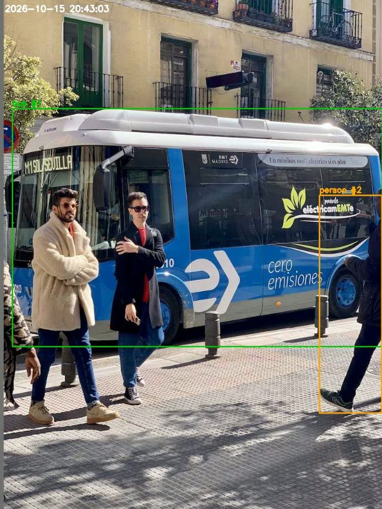

# Day 15: Integration and the final demo

**Hours 43-45 of 45** · **Milestone 9:** the finished Intelligence System · **Final demo in hour 45**

## What you can do at the end of today

- Connect every part (camera, detector, tracker, rules, memory, notifier) in one program.
- Run it with a safe `--dry-run`, and then for real with Telegram photo alerts.
- Test the whole system, and tune it with a recorded clip.
- Add a rule of your own and test it.
- Explain the privacy and ethics of a camera that watches people.
- Show your finished system to others, and explain how it works and what it cannot do.

## Where today fits in the project

You have built every piece. Today you connect the last wires, and prove that the whole thing works.

```text
 webcam / video file
        │
        ▼
 ┌──────────────┐   ┌─────────────┐   ┌────────────────┐   ┌───────────────┐
 │ Detector     │──►│ Tracks      │──►│ RuleEngine     │──►│ should_alert  │
 │ YOLO+ByteTrack│  │ appeared /  │   │ severity+reasons│  │ once, cooldown │
 │ (Day 12-13)  │   │ left (D13)  │   │ (Day 14)       │   │ (Day 14)      │
 └──────────────┘   └──────┬──────┘   └───────┬────────┘   └──────┬────────┘
                           │                  │                   │
                           ▼                  ▼                   ▼
                    EventStore (SQLite)   overlay on screen   snapshot.jpg ──► TelegramNotifier ──► your phone
                       (Day 9)             (Day 7)                              (Day 10-11, a worker thread)
```

New today in `main()`: the **flags** (`--config`, `--dry-run`, `--history`), the **secrets**, the **notifier**, **writing every event to the database**, the **snapshot** that goes with an alert, and a **clean shutdown**.

## Plan for the day

| Hour | Minutes | Activity |
|---|---|---|
| 43 | 10 | Review the architecture diagram, list what is missing |
| | 15 | Talk: the shape of the finished `main()` |
| | 35 | **Lab 15.1 (Milestone 9)** Wire everything together, first `--dry-run` |
| 44 | 10 | Tests that never send real messages, `check_all` |
| | 20 | **Lab 15.2** Your own rule |
| | 10 | Talk and discussion: privacy and ethics |
| | 20 | **Labs 15.3-15.4** Tuning note, README |
| 45 | 10 | Demo preparation (checklist below) |
| | 40 | **Final demos** |
| | 10 | Retrospective and next steps |

---

# Hour 43: Wire it together (Milestone 9)

## Learn: the finished `main()`

Everything you need already exists. What is left is **orchestration**: `main()` is the conductor that starts the instruments and keeps them in time. Read the finished program from top to bottom as a story:

1. **Read the options and the settings.** `--config` (a different settings file), `--source`, `--no-window`, `--dry-run`, `--history`.
2. **Open the memory.** `EventStore`.
3. **`--history`?** Print what the system has seen and stop. (This happens *before* the slow detector is loaded.)
4. **Read the secrets.** The token and the chat id from `.env`. Without `--dry-run` they are required.
5. **Start the instruments.** Detector, rule engine, notifier, camera.
6. **Loop.** For every frame: detect, update tracks, confirm, assess, log events, alert, show.
7. **Shut down cleanly.** Close the tracks, release the camera, say goodbye on Telegram, **flush** the notifier, close the database.

### Every event goes to the memory

| When | `store.add(kind, ...)` | What it records |
|---|---|---|
| a track is confirmed | `"appeared"` | label, zones, severity, reasons |
| it enters a new zone | `"zone_enter"` | the zone |
| an alert is sent | `"alert"` | severity, reasons, the snapshot file |
| a confirmed track is gone | `"left"` | how long it was seen |

This is what the history rule (Day 14) and `--history` read.

### The alert is a photo with a story

When `should_alert` says yes, the program: (1) takes a **copy** of the frame and draws the overlay on it (boxes, zone, time), so the photo shows what the system saw and decided; (2) saves it as `snapshots/YYYYmmdd_HHMMSS_<label>_<id>.jpg`; (3) writes the `alert` event with the file name; (4) queues the photo with a caption: an icon (ℹ️ ⚠️ 🚨), the severity word, the **reasons**, the time and the object.

## Lab 15.1 (Milestone 9): Update `app.py`

You change `intelligence/app.py` in six steps. A complete copy of the file is at the end of this lab, in a collapsed section, so you can compare with yours.

**Step 1. Imports and icons** at the top of the file. New: `import sys`, `PROJECT_ROOT`, `load_env`, the `TelegramNotifier`, and the table of alert icons:

**`intelligence/app.py`** top of app.py

```python
import argparse
import sys
import time
from dataclasses import dataclass, field
from datetime import datetime

import cv2

from . import PROJECT_ROOT
from .config import load_config, load_env, project_path
from .events import EventStore
from .rules import SEVERITY_NAMES, RuleEngine, should_alert
from .telegram_bot import TelegramNotifier

SEVERITY_COLORS = {0: (160, 160, 160), 1: (0, 200, 0), 2: (0, 165, 255), 3: (0, 0, 255)}  # BGR
SEVERITY_ICONS = {1: "ℹ️", 2: "⚠️", 3: "🚨"}
```

**Step 2. `print_history`.** Add it above `draw_overlay`. It prints today's summary (how many times each label appeared, how many alerts) and the last `limit` events:

**`intelligence/app.py`** above draw_overlay

```python
def print_history(store, limit):
    print("\nToday's summary (label: seen / alerts)")
    for label, seen, alerts in store.today_summary():
        print(f"  {label:12} {seen} / {alerts}")
    print(f"\nLast {limit} events")
    for ts, kind, label, track_id, zone, severity, alerted, detail in store.recent(limit):
        print(f"  {ts}  {kind:10} {label or '':10} #{track_id}  sev={severity}  {detail or ''}")
```

**Step 3. The beginning of `main()`.** The new options, the emoji fix for Windows consoles (`sys.stdout.reconfigure(errors="replace")`: alerts contain emoji, and a redirected Windows console would otherwise raise an error on them), the secrets, and the early exit for `--history`:

**`intelligence/app.py`** the start of main()

```python
def main():
    ap = argparse.ArgumentParser(description="Webcam security camera with detection, memory and Telegram alerts")
    ap.add_argument("--config", help="path to a config json (default: config.json in the project)")
    ap.add_argument("--source", help="camera index or video file (overrides config)")
    ap.add_argument("--no-window", action="store_true", help="run without the preview window")
    ap.add_argument("--dry-run", action="store_true", help="print alerts instead of sending them to Telegram")
    ap.add_argument("--history", type=int, metavar="N", help="print today's summary and the last N events, then exit")
    args = ap.parse_args()

    # Alerts contain emoji; a redirected Windows console (cp1252) would raise on them.
    sys.stdout.reconfigure(errors="replace")

    cfg = load_config(args.config)
    store = EventStore(project_path(cfg["paths"]["database"]))

    if args.history:
        print_history(store, args.history)
        return

    env = load_env(PROJECT_ROOT / ".env")
    token, chat_id = env.get("TELEGRAM_BOT_TOKEN", ""), env.get("TELEGRAM_CHAT_ID", "")
    if not args.dry_run and (not token or not chat_id):
        raise SystemExit("Set TELEGRAM_BOT_TOKEN and TELEGRAM_CHAT_ID in the .env file (or use --dry-run).")

    # Imported here so --history stays instant (loading PyTorch takes a few seconds).
    from .detector import Detector

    snapshot_dir = project_path(cfg["paths"]["snapshots"])
    snapshot_dir.mkdir(parents=True, exist_ok=True)
    model_path = project_path(cfg["paths"]["models"]) / cfg["model"]
    model_path.parent.mkdir(parents=True, exist_ok=True)

    print(f"Loading {model_path.name} ...")
```

Check these details:

- `load_config(args.config)` uses the file after `--config`, or `config.json` when it is `None`.
- `if args.history: print_history(...); return` stops **before** loading PyTorch, so `--history` answers at once.
- The check `not args.dry_run and (not token or not chat_id)` makes secrets required **only** for a real run.
- `from .detector import Detector` is inside `main()`, as before.

**Step 4. Start the instruments:**

**`intelligence/app.py`** detector, rules, notifier and camera

```python
    detector = Detector(model_path, cfg["watch_classes"], cfg["confidence"], cfg["image_size"], cfg["device"])
    rules = RuleEngine(cfg, store)
    notifier = TelegramNotifier(token, chat_id, dry_run=args.dry_run)

    source = parse_source(args.source if args.source is not None else cfg["source"])
    is_file = isinstance(source, str)
    cap = cv2.VideoCapture(source)
    if not cap.isOpened():
        raise SystemExit(
            f"Cannot open source {source!r}. For a camera on macOS, allow camera access for your "
            "terminal/VS Code in System Settings > Privacy & Security > Camera."
        )
```

**Step 5. State, the start message and `finish_track`.** `finish_track` now also writes the `left` event. And we say hello on Telegram:

**`intelligence/app.py`** state, the start message and finish_track

```python
    min_frames = cfg["min_track_frames"]
    lost_after = cfg["lost_seconds"]
    alert_cfg = cfg["alert"]
    tracks = {}
    last_alert = 0.0

    notifier.send_text(f"Security camera started (device: {detector.device}).")
    print(f"Running on {detector.device}. Press q to quit.")

    def finish_track(t):
        if t.confirmed:
            store.add("left", t.track_id, t.label, severity=t.severity,
                      detail=f"seen {t.last_seen - t.first_seen:.0f}s")
            print(f"[{datetime.now():%H:%M:%S}] {t.label} #{t.track_id} left after {t.last_seen - t.first_seen:.0f}s")
```

**Step 6. The loop and the shutdown.** This is the biggest part. Read the comments in the code and compare with the life cycle from Day 13 and the policy from Day 14. New: the `store.add(...)` calls, and the whole `if should_alert(...)` block (copy, overlay, snapshot, event, photo):

**`intelligence/app.py`** the loop

```python
    try:
        while True:
            ok, frame = cap.read()
            if not ok:
                if is_file:
                    break
                print("Camera read failed, retrying...")
                time.sleep(0.5)
                continue

            now, clock = datetime.now(), time.monotonic()
            seen_ids = set()

            for det in detector.track(frame):
                seen_ids.add(det.track_id)
                t = tracks.get(det.track_id)
                if t is None:
                    t = tracks[det.track_id] = Track(det.track_id, det.label, clock, clock)
                t.last_seen, t.box, t.label = clock, det.box, det.label
                t.frames += 1

                if not t.confirmed and t.frames >= min_frames:
                    t.confirmed = True
                    t.zones.update(rules.zones_for(t.label, t.box, frame.shape))
                    a = rules.assess(t.label, t.zones, now)
                    store.add("appeared", t.track_id, t.label, ",".join(sorted(t.zones)) or None,
                              a.severity, detail=a.describe(), ts=now)
                    print(f"[{now:%H:%M:%S}] {t.label} #{t.track_id} appeared ({SEVERITY_NAMES[a.severity]}: {a.describe()})")
                if not t.confirmed:
                    continue

                for zone in set(rules.zones_for(t.label, t.box, frame.shape)) - t.zones:
                    t.zones.add(zone)
                    store.add("zone_enter", t.track_id, t.label, zone, t.severity, ts=now)
                    print(f"[{now:%H:%M:%S}] {t.label} #{t.track_id} entered {zone}")

                a = rules.assess(t.label, t.zones, now)
                t.severity = a.severity

                # Alert once per track, and again only if it becomes more serious (see should_alert).
                if should_alert(a.severity, t.alerted_severity, time.time() - last_alert, alert_cfg):
                    last_alert = time.time()
                    t.alerted_severity = a.severity

                    annotated = frame.copy()
                    draw_overlay(annotated, [x for x in tracks.values() if x.track_id in seen_ids], rules, now)
                    path = snapshot_dir / f"{now:%Y%m%d_%H%M%S}_{t.label}_{t.track_id}.jpg"
                    cv2.imwrite(str(path), annotated)

                    store.add("alert", t.track_id, t.label, ",".join(sorted(t.zones)) or None,
                              a.severity, alerted=True, snapshot=str(path), detail=a.describe(), ts=now)
                    notifier.send_photo(
                        path, f"{SEVERITY_ICONS[a.severity]} {SEVERITY_NAMES[a.severity]}: {a.describe()}\n"
                              f"{now:%Y-%m-%d %H:%M:%S}  ({t.label} #{t.track_id})")

            for tid in [tid for tid, t in tracks.items() if tid not in seen_ids and clock - t.last_seen > lost_after]:
                finish_track(tracks.pop(tid))

            if not args.no_window:
                draw_overlay(frame, [x for x in tracks.values() if x.track_id in seen_ids], rules, now)
                cv2.imshow("Security Camera", frame)
                if cv2.waitKey(1) & 0xFF == ord("q"):
                    break
```

And the shutdown, in `finally`, in this order: close the tracks that are still open, release the camera, close the windows, **say goodbye**, **flush** (wait until the notifier has really sent everything), close the database:

**`intelligence/app.py`** the shutdown

```python
    except KeyboardInterrupt:
        pass
    finally:
        for t in tracks.values():
            finish_track(t)
        cap.release()
        cv2.destroyAllWindows()
        notifier.send_text("Security camera stopped.")
        notifier.flush()
        store.close()
```

<details><summary>The complete file, to compare with yours</summary>

**`intelligence/app.py`**

```python
import argparse
import sys
import time
from dataclasses import dataclass, field
from datetime import datetime

import cv2

from . import PROJECT_ROOT
from .config import load_config, load_env, project_path
from .events import EventStore
from .rules import SEVERITY_NAMES, RuleEngine, should_alert
from .telegram_bot import TelegramNotifier

SEVERITY_COLORS = {0: (160, 160, 160), 1: (0, 200, 0), 2: (0, 165, 255), 3: (0, 0, 255)}  # BGR
SEVERITY_ICONS = {1: "ℹ️", 2: "⚠️", 3: "🚨"}


@dataclass
class Track:
    track_id: int
    label: str
    first_seen: float
    last_seen: float
    box: tuple = (0, 0, 0, 0)
    frames: int = 0
    confirmed: bool = False
    zones: set = field(default_factory=set)
    severity: int = 0
    alerted_severity: int = 0


def parse_source(value):
    return int(value) if str(value).isdigit() else value


def print_history(store, limit):
    print("\nToday's summary (label: seen / alerts)")
    for label, seen, alerts in store.today_summary():
        print(f"  {label:12} {seen} / {alerts}")
    print(f"\nLast {limit} events")
    for ts, kind, label, track_id, zone, severity, alerted, detail in store.recent(limit):
        print(f"  {ts}  {kind:10} {label or '':10} #{track_id}  sev={severity}  {detail or ''}")


def draw_overlay(frame, tracks, rules, now):
    for name, polygon in rules.zone_polygons(frame.shape):
        pts = polygon.astype("int32")
        cv2.polylines(frame, [pts], True, (255, 200, 0), 1)
        cv2.putText(frame, name, tuple(pts[0]), cv2.FONT_HERSHEY_SIMPLEX, 0.5, (255, 200, 0), 1)

    for t in tracks:
        x1, y1, x2, y2 = (int(v) for v in t.box)
        color = SEVERITY_COLORS[t.severity] if t.confirmed else (120, 120, 120)
        cv2.rectangle(frame, (x1, y1), (x2, y2), color, 2 if t.confirmed else 1)
        text = f"{t.label} #{t.track_id}"
        if t.zones:
            text += " [" + ",".join(sorted(t.zones)) + "]"
        cv2.putText(frame, text, (x1, max(y1 - 6, 14)), cv2.FONT_HERSHEY_SIMPLEX, 0.55, color, 2)

    cv2.putText(frame, f"{now:%Y-%m-%d %H:%M:%S}", (10, 24),
                cv2.FONT_HERSHEY_SIMPLEX, 0.6, (255, 255, 255), 2)


def main():
    ap = argparse.ArgumentParser(description="Webcam security camera with detection, memory and Telegram alerts")
    ap.add_argument("--config", help="path to a config json (default: config.json in the project)")
    ap.add_argument("--source", help="camera index or video file (overrides config)")
    ap.add_argument("--no-window", action="store_true", help="run without the preview window")
    ap.add_argument("--dry-run", action="store_true", help="print alerts instead of sending them to Telegram")
    ap.add_argument("--history", type=int, metavar="N", help="print today's summary and the last N events, then exit")
    args = ap.parse_args()

    # Alerts contain emoji; a redirected Windows console (cp1252) would raise on them.
    sys.stdout.reconfigure(errors="replace")

    cfg = load_config(args.config)
    store = EventStore(project_path(cfg["paths"]["database"]))

    if args.history:
        print_history(store, args.history)
        return

    env = load_env(PROJECT_ROOT / ".env")
    token, chat_id = env.get("TELEGRAM_BOT_TOKEN", ""), env.get("TELEGRAM_CHAT_ID", "")
    if not args.dry_run and (not token or not chat_id):
        raise SystemExit("Set TELEGRAM_BOT_TOKEN and TELEGRAM_CHAT_ID in the .env file (or use --dry-run).")

    # Imported here so --history stays instant (loading PyTorch takes a few seconds).
    from .detector import Detector

    snapshot_dir = project_path(cfg["paths"]["snapshots"])
    snapshot_dir.mkdir(parents=True, exist_ok=True)
    model_path = project_path(cfg["paths"]["models"]) / cfg["model"]
    model_path.parent.mkdir(parents=True, exist_ok=True)

    print(f"Loading {model_path.name} ...")
    detector = Detector(model_path, cfg["watch_classes"], cfg["confidence"], cfg["image_size"], cfg["device"])
    rules = RuleEngine(cfg, store)
    notifier = TelegramNotifier(token, chat_id, dry_run=args.dry_run)

    source = parse_source(args.source if args.source is not None else cfg["source"])
    is_file = isinstance(source, str)
    cap = cv2.VideoCapture(source)
    if not cap.isOpened():
        raise SystemExit(
            f"Cannot open source {source!r}. For a camera on macOS, allow camera access for your "
            "terminal/VS Code in System Settings > Privacy & Security > Camera."
        )

    min_frames = cfg["min_track_frames"]
    lost_after = cfg["lost_seconds"]
    alert_cfg = cfg["alert"]
    tracks = {}
    last_alert = 0.0

    notifier.send_text(f"Security camera started (device: {detector.device}).")
    print(f"Running on {detector.device}. Press q to quit.")

    def finish_track(t):
        if t.confirmed:
            store.add("left", t.track_id, t.label, severity=t.severity,
                      detail=f"seen {t.last_seen - t.first_seen:.0f}s")
            print(f"[{datetime.now():%H:%M:%S}] {t.label} #{t.track_id} left after {t.last_seen - t.first_seen:.0f}s")

    try:
        while True:
            ok, frame = cap.read()
            if not ok:
                if is_file:
                    break
                print("Camera read failed, retrying...")
                time.sleep(0.5)
                continue

            now, clock = datetime.now(), time.monotonic()
            seen_ids = set()

            for det in detector.track(frame):
                seen_ids.add(det.track_id)
                t = tracks.get(det.track_id)
                if t is None:
                    t = tracks[det.track_id] = Track(det.track_id, det.label, clock, clock)
                t.last_seen, t.box, t.label = clock, det.box, det.label
                t.frames += 1

                if not t.confirmed and t.frames >= min_frames:
                    t.confirmed = True
                    t.zones.update(rules.zones_for(t.label, t.box, frame.shape))
                    a = rules.assess(t.label, t.zones, now)
                    store.add("appeared", t.track_id, t.label, ",".join(sorted(t.zones)) or None,
                              a.severity, detail=a.describe(), ts=now)
                    print(f"[{now:%H:%M:%S}] {t.label} #{t.track_id} appeared ({SEVERITY_NAMES[a.severity]}: {a.describe()})")
                if not t.confirmed:
                    continue

                for zone in set(rules.zones_for(t.label, t.box, frame.shape)) - t.zones:
                    t.zones.add(zone)
                    store.add("zone_enter", t.track_id, t.label, zone, t.severity, ts=now)
                    print(f"[{now:%H:%M:%S}] {t.label} #{t.track_id} entered {zone}")

                a = rules.assess(t.label, t.zones, now)
                t.severity = a.severity

                # Alert once per track, and again only if it becomes more serious (see should_alert).
                if should_alert(a.severity, t.alerted_severity, time.time() - last_alert, alert_cfg):
                    last_alert = time.time()
                    t.alerted_severity = a.severity

                    annotated = frame.copy()
                    draw_overlay(annotated, [x for x in tracks.values() if x.track_id in seen_ids], rules, now)
                    path = snapshot_dir / f"{now:%Y%m%d_%H%M%S}_{t.label}_{t.track_id}.jpg"
                    cv2.imwrite(str(path), annotated)

                    store.add("alert", t.track_id, t.label, ",".join(sorted(t.zones)) or None,
                              a.severity, alerted=True, snapshot=str(path), detail=a.describe(), ts=now)
                    notifier.send_photo(
                        path, f"{SEVERITY_ICONS[a.severity]} {SEVERITY_NAMES[a.severity]}: {a.describe()}\n"
                              f"{now:%Y-%m-%d %H:%M:%S}  ({t.label} #{t.track_id})")

            for tid in [tid for tid, t in tracks.items() if tid not in seen_ids and clock - t.last_seen > lost_after]:
                finish_track(tracks.pop(tid))

            if not args.no_window:
                draw_overlay(frame, [x for x in tracks.values() if x.track_id in seen_ids], rules, now)
                cv2.imshow("Security Camera", frame)
                if cv2.waitKey(1) & 0xFF == ord("q"):
                    break
    except KeyboardInterrupt:
        pass
    finally:
        for t in tracks.values():
            finish_track(t)
        cap.release()
        cv2.destroyAllWindows()
        notifier.send_text("Security camera stopped.")
        notifier.flush()
        store.close()
```

</details>

Also update the docstring at the top of `security_camera.py`, so that anybody who opens it sees how to use the program:

**`security_camera.py`**

```python
"""
Security camera intelligence system.

Run (inside the python-course conda env, from this folder):
    python security_camera.py                  # live camera, alerts to Telegram
    python security_camera.py --dry-run        # print alerts instead of sending them
    python security_camera.py --source clip.mp4 --no-window
    python security_camera.py --history 20     # what has the system seen?

Telegram token and chat id come from .env, everything else from config.json.
Press "q" in the preview window (or Ctrl+C) to quit.
"""

from intelligence.app import main

if __name__ == "__main__":
    main()
```

## Run it, safely first

`--dry-run` runs everything, but prints the Telegram messages instead of sending them. Use it on the clip first:

```text
$ python security_camera.py --source clip.mp4 --no-window --dry-run
Loading yolo11n.pt ...
Running on mps. Press q to quit.
[telegram dry-run] sendMessage: Security camera started (device: mps).
[20:43:03] bus #1 appeared (low: bus)
[20:43:03] person #2 appeared (medium: person)
[telegram dry-run] sendPhoto: ⚠️ medium: person
2026-10-15 20:43:03  (person #2)
[20:43:03] person #3 appeared (medium: person)
[20:43:03] person #4 appeared (medium: person)
[20:43:03] person #5 appeared (medium: person)
[20:43:04] bus #1 left after 1s
[20:43:04] person #2 left after 1s
[20:43:04] person #3 left after 1s
[20:43:04] person #4 left after 1s
[20:43:04] person #5 left after 1s
[telegram dry-run] sendMessage: Security camera stopped.
```

(The first line, the device and the times will differ on your computer. Lines from the notifier come from the worker thread, so they can appear a little earlier or later than the lines around them.)

What to look for: `Security camera started` (dry run), `appeared` lines with the severity and reasons, `ALERT`-photos (`sendPhoto`) for the first person, **no** alert for the low `bus` (below `min_severity`), `left after` lines, and `Security camera stopped`.

Now ask the memory what happened:

```text
$ python security_camera.py --history 8

Today's summary (label: seen / alerts)
  person       4 / 1
  bus          1 / 0

Last 8 events
  2026-10-15T20:43:04  left       person     #5  sev=2  seen 1s
  2026-10-15T20:43:04  left       person     #4  sev=2  seen 1s
  2026-10-15T20:43:04  left       person     #3  sev=2  seen 1s
  2026-10-15T20:43:04  left       person     #2  sev=2  seen 1s
  2026-10-15T20:43:04  left       bus        #1  sev=1  seen 1s
  2026-10-15T20:43:03  appeared   person     #5  sev=2  person
  2026-10-15T20:43:03  appeared   person     #4  sev=2  person
  2026-10-15T20:43:03  appeared   person     #3  sev=2  person
```

You can ask the database anything with the SQL tool from Day 9 too:

```text
$ python -m tools.run_sql data/events.db "SELECT kind, label, severity, detail FROM events ORDER BY id LIMIT 6"
kind      label   severity  detail
--------  ------  --------  ------
appeared  bus     1         bus   
appeared  person  2         person
alert     person  2         person
appeared  person  2         person
appeared  person  2         person
appeared  person  2         person
(6 rows)
```

The `alert` row has the file name of the photo. Here is the photo from this run: this is what the alert on your phone looks like. Look closely: it shows the **bus and person #2** (the object that caused the alert), but **not the other three people**, even though they are in the frame. Why? The loop handles the detections of one frame **one after the other**, and it takes the photo the moment person #2 triggers the alert, before it has looked at the others. This is a real limitation of the design (see the fast-finisher ideas at the end of the day).



## Run it for real

When `--dry-run` looks right, send real messages. Your token and chat id come from `.env`:

```bash
python security_camera.py --source clip.mp4 --no-window
```

Your phone should receive: **Security camera started**, one or more **photos** with captions such as `⚠️ medium: person` (or `🚨 HIGH: ...`), and finally **Security camera stopped**. Then run it on your **webcam**, walk in, and wait for the alert. Press `q` in the window to stop.

If nothing arrives, go through this list:

| Check | How |
|---|---|
| Is `--dry-run` still on? | run without it |
| Is `.env` right? | `python -m tools.telegram_check --send` must say `message: sent` |
| Is the alert below `min_severity`? | read the `appeared (...)` lines: only 2 and 3 are sent |
| Cooldown? | a second alert within `cooldown_seconds` waits (except HIGH) |
| Did the program end too fast? | the shutdown code calls `flush()`, but if you kill the terminal the queue is lost |

## Check yourself

1. Why does `--history` run before the detector is loaded?
2. Which four kinds of events are written to the database, and when?
3. Why does the program take a *copy* of the frame for the alert photo?
4. What is the order of the shutdown steps, and why must the notifier be flushed before the database is closed?

<details><summary>Answers</summary>

1. Loading PyTorch takes seconds, and the history does not need it. The answer should be instant.
2. `appeared` (a track is confirmed), `zone_enter` (it enters a new zone), `alert` (an alert is sent), `left` (a confirmed track is gone).
3. Drawing changes the frame. A copy lets us draw the overlay on the photo without drawing a second time on the frame that goes to the window.
4. Close tracks, release camera and windows, say goodbye, **flush**, close the database. Flush first so that unsent messages are not lost when the program ends; the database is closed last because every step before it may still write events.

</details>

---

# Hour 44: Test it, own it, think about it

## Tests that never send a real message

Two of your tests start the whole program. If they ran it for real, **every test run would message your phone and fill your real history**. So they follow two rules:

1. They use `--dry-run`.
2. `check_pipeline` writes to a **temporary** database and snapshot folder, through a private copy of the settings (`--config`). Your real memory is never touched.

Replace `tests/check_app.py` and `tests/check_pipeline.py` with these versions. `check_pipeline` is now the full end-to-end test: a video made from the bus photo goes in, and it checks the life cycle, that the alert was "sent" and a snapshot saved, that the **database** has `appeared`, `alert` and `left` events, and that `--history` prints them.

**`tests/check_app.py`**

```python
import subprocess
import sys
from pathlib import Path

import cv2
import numpy as np

from intelligence.app import parse_source

# parse_source: a camera number becomes an int, a file name stays text
assert parse_source("0") == 0
assert parse_source(2) == 2
assert parse_source("clip.mp4") == "clip.mp4"

# Make a tiny video of 10 grey frames and run the whole program on it, without a window.
# --dry-run: the program prints what it would send to Telegram, so a test never sends a message.
Path("output").mkdir(exist_ok=True)
writer = cv2.VideoWriter("output/tiny.mp4", cv2.VideoWriter_fourcc(*"mp4v"), 10, (160, 120))
for i in range(10):
    writer.write(np.full((120, 160, 3), 20 * i, np.uint8))
writer.release()

result = subprocess.run(
    [sys.executable, "security_camera.py", "--source", "output/tiny.mp4", "--no-window", "--dry-run"],
    capture_output=True, text=True,
)
assert result.returncode == 0, result.stderr
assert "Running on" in result.stdout, result.stdout  # the detector was loaded and the loop ran
assert "Security camera started" in result.stdout  # the start message (dry run)
assert "Security camera stopped" in result.stdout  # and the stop message, sent by the shutdown code
assert "appeared" not in result.stdout  # a grey picture has no objects in it

# A source that does not exist gives a friendly message, not a traceback
result = subprocess.run(
    [sys.executable, "security_camera.py", "--source", "no_such_file.mp4", "--no-window", "--dry-run"],
    capture_output=True, text=True,
)
assert result.returncode != 0
assert "Cannot open source" in result.stderr, result.stderr
assert "Traceback" not in result.stderr, result.stderr

print("app OK")
```

**`tests/check_pipeline.py`**

```python
import json
import subprocess
import sys
import tempfile
from pathlib import Path

import cv2
from ultralytics.utils import ASSETS

from intelligence.config import load_config
from intelligence.events import EventStore

with tempfile.TemporaryDirectory() as folder:
    folder = Path(folder)

    # A short video made from one photo: 12 identical frames
    frame = cv2.imread(str(ASSETS / "bus.jpg"))
    height, width = frame.shape[:2]
    video = folder / "bus_clip.mp4"
    writer = cv2.VideoWriter(str(video), cv2.VideoWriter_fourcc(*"mp4v"), 10, (width, height))
    for _ in range(12):
        writer.write(frame)
    writer.release()

    # A private copy of the settings: the test must not touch your real history or snapshots
    cfg = load_config()
    cfg["paths"]["database"] = str(folder / "events.db")
    cfg["paths"]["snapshots"] = str(folder / "snapshots")
    config_file = folder / "config.json"
    config_file.write_text(json.dumps(cfg))

    command = [sys.executable, "security_camera.py", "--config", str(config_file)]
    result = subprocess.run(command + ["--source", str(video), "--no-window", "--dry-run"],
                            capture_output=True, text=True)
    assert result.returncode == 0, result.stderr
    out = result.stdout

    # 1. The track life cycle: everything that appeared also left
    appeared = [line for line in out.splitlines() if " appeared" in line]
    left = [line for line in out.splitlines() if " left after" in line]
    assert any("bus" in line for line in appeared), out
    assert sum("person" in line for line in appeared) >= 3, out
    assert len(left) == len(appeared), "every object that appeared must also be reported as left"

    # 2. Alerts: a snapshot was saved and the alert was "sent" (dry run, so only printed)
    assert "[telegram dry-run] sendMessage: Security camera started" in out
    assert "[telegram dry-run] sendPhoto" in out, out
    assert "[telegram dry-run] sendMessage: Security camera stopped" in out
    assert list((folder / "snapshots").glob("*.jpg")), "no snapshot was saved"

    # 3. Memory: the events are in the database
    store = EventStore(folder / "events.db")
    kinds = {row[1] for row in store.recent(100)}
    assert {"appeared", "alert", "left"} <= kinds, kinds
    persons = [row for row in store.today_summary() if row[0] == "person"]
    assert persons and persons[0][1] >= 3 and persons[0][2] >= 1, store.today_summary()
    store.close()

    # 4. --history prints what the system has seen
    history = subprocess.run(command + ["--history", "5"], capture_output=True, text=True)
    assert history.returncode == 0, history.stderr
    assert "Today's summary" in history.stdout and "Last 5 events" in history.stdout, history.stdout
    assert "person" in history.stdout

print(f"pipeline OK: {len(appeared)} objects appeared and left, alerts sent, events saved")
```

Then add `tests/check_all.py`. It finds every `check_*.py` and runs them one after another:

**`tests/check_all.py`**

```python
"""Run every self-check and print a summary:   python -m tests.check_all"""
import subprocess
import sys
from pathlib import Path

checks = sorted(path.stem for path in Path(__file__).parent.glob("check_*.py") if path.stem != "check_all")

failed = []
for name in checks:
    result = subprocess.run([sys.executable, "-m", f"tests.{name}"], capture_output=True, text=True)
    if result.returncode == 0:
        print(f"  ok      {name}")
    else:
        failed.append(name)
        print(f"  FAILED  {name}")
        print((result.stdout + result.stderr)[-1500:])

print()
if failed:
    raise SystemExit(f"{len(failed)} of {len(checks)} checks failed: {', '.join(failed)}")
print(f"All {len(checks)} checks passed.")
```

```text
$ python -m tests.check_all
  ok      check_app
  ok      check_config
  ok      check_detector
  ok      check_events
  ok      check_history
  ok      check_notifier
  ok      check_overlay
  ok      check_pipeline
  ok      check_policy
  ok      check_rules

All 10 checks passed.
```

From now on, run `python -m tests.check_all` **before every commit**. If a test fails, the output of the failing check is shown. Fix the cause, never delete the test.

## Lab 15.2: Your own rule

Every student must add **one rule of their own** to `RuleEngine.assess`, with a test. It can be small; what counts is that you decide, write and test it. Ideas that work with what `assess` knows (the label, the zones and the time):

| Idea | Sketch |
|---|---|
| **The weekend** is more serious | `now.weekday() >= 5` adds a point |
| **The school run** (07:30 to 08:30) is normal | subtract a point at those times |
| A **dog in the garden zone at night** matters | a special case before the guard clause |
| Two zones at once is more serious | `len(zones) >= 2` |
| Your own `label_severity` for something new (`"backpack"`) | config only, then a test |

Here is a complete worked example: **the weekend**. In `rules.py`, in `assess`, add these lines (for example just above the `if zones:` block):

```python
        if now.weekday() >= 5:  # Saturday is 5, Sunday is 6 (Monday is 0)
            score += 1
            reasons.append("at the weekend")
```

Now the test. It has a test for each side of the rule: a normal day (unchanged), the weekend (one point more), the reason text, and a check that a dog still stays at 0. Choose your dates with care: use `datetime(...).weekday()` to prove the day of the week, as the test does.

**`tests/example_weekend.py`**

```python
"""An example test for an OWN rule: "a sighting at the weekend is more serious".

Add the rule to RuleEngine.assess first (see the lesson), then save this file as
tests/check_weekend.py and run:   python -m tests.check_weekend
"""
from datetime import datetime

from intelligence.config import load_config
from intelligence.rules import RuleEngine

cfg = load_config()
cfg["anomaly"]["enabled"] = False  # keep the history rule out of this test
engine = RuleEngine(cfg)

WEDNESDAY_NOON = datetime(2026, 3, 11, 12, 0)
SATURDAY_NOON = datetime(2026, 3, 14, 12, 0)
assert WEDNESDAY_NOON.weekday() == 2 and SATURDAY_NOON.weekday() == 5  # Monday is 0, Sunday is 6

assert engine.assess("car", set(), WEDNESDAY_NOON).severity == 1  # an ordinary weekday: unchanged
assert engine.assess("car", set(), SATURDAY_NOON).severity == 2  # the weekend: one point more
assert engine.assess("person", set(), SATURDAY_NOON).describe() == "person, at the weekend"
assert engine.assess("dog", set(), SATURDAY_NOON).severity == 0  # a dog is still never an alert

print("weekend rule OK")
```

Save it as `tests/check_weekend.py`. Run it **before** you add the rule: it must **fail** (a test that cannot fail tells you nothing). Add the rule, run again: it passes. Then run `python -m tests.check_all`: all checks (including the older ones) must still pass.

Now write your own rule and your own test. Keep your rule in `assess`, your test in `tests/check_<name>.py`, and describe the rule in your README.

## Talk and discussion: a camera that watches people

You built a system that watches people and stores their picture. Before you show it, think.

**Real situations. Discuss each one in pairs (3 minutes) and then as a class:**

1. A student points the camera at the **window of the neighbour's house** to see the street. What is wrong with that?
2. A shop owner installs it **inside the shop**. Which signs and which rules do they need?
3. A parent uses it in the **child's bedroom**. What are the risks, even when the parent has good intentions?
4. The system sends an alert about a "person" at 3 a.m. It was the **night-shift neighbour** walking home. Who is responsible for the mistake?
5. Photos are kept **for a year** "in case". Why is this a bad idea?

**Principles to remember:**

| Principle | What it means for your project |
|---|---|
| **Permission** | Record only places and people you have the right to record. The law is different in every country: ask before you install. |
| **Purpose** | Use the camera for the reason you installed it (security of your own door), nothing else. |
| **Minimum** | Keep only what you need. Photos of alerts, not video all day. Delete old snapshots regularly. |
| **Transparency** | People should know a camera is there: a sign is simple and fair. |
| **Security** | The photos are sensitive. The Telegram chat, the `snapshots/` folder, the database and the token must be protected. A leaked token means a stranger can read your photos. |
| **Humility about the AI** | YOLO can miss a person (dark clothes, odd poses, bad light) and can see a person in a coat on a chair. A system like this **helps**, it does not **guarantee** safety. Never present it as a replacement for real security. |

Write your answer to the question "Where does my camera look, who knows about it, and when do I delete the photos?" in your README (Lab 15.4).

## Lab 15.3: The tuning note

The last item of the rubric is to explain **one false alarm or one miss and how you reduced it**. Take your clip (or record a new one that shows a problem: a shadow, a chair, a light switched on, a person at the edge of the picture). Then follow the process:

1. **Find a problem** you can reproduce on the clip.
2. **Collect the evidence** from the console lines (`appeared`, `ALERT`) and the database.
3. **Explain** which setting or rule probably caused it.
4. **Change one thing** and run the same clip again.
5. **Compare**, and write down **the price**: every setting has a cost.

Use the template (copy it from `solutions/day15/project/TUNING_NOTE.template.md` into your project and fill it in). Here is an example of the kind of reasoning that earns full marks:

| Part | Example |
|---|---|
| Problem | "A `person #4` appeared and an alert was sent, but it was a coat on a chair." |
| Evidence | "`person #4 appeared (medium: person)`, confidence about 0.5 in the first frames." |
| Explanation | "`confidence` is 0.45: low enough to accept a coat." |
| Change | "`confidence` 0.45 to 0.6." |
| Result | "The coat is not detected any more. The real person is still found." |
| Price | "A person who is far away or in the dark (confidence 0.5 to 0.6) is now missed." |

**`TUNING_NOTE.template.md`**

```markdown
# Tuning note

**Name:** &nbsp;&nbsp;&nbsp; **Date:**

## 1. The problem

*What went wrong? A false alarm (an alert for nothing) or a miss (no alert when there should be one)?
Which clip? Which console lines show it?*

## 2. The evidence

*Paste 2 to 5 lines of the program's output, or describe the picture (what was in front of the camera, the light, the distance).*

## 3. My explanation

*Which setting or rule do you think caused it? Why?*

## 4. The change

| Setting | Before | After |
|---|---|---|
| | | |

*Change only one thing at a time.*

## 5. The result

*Run the same clip again. What changed? Is the problem gone?*

## 6. The price

*Every change has a cost. What gets worse now? (For example: a higher confidence means fewer false alarms but you might miss a person who is far away.)*
```

## Lab 15.4: The README

Copy `README.template.md` into your project folder as `README.md` and fill in every section. A good README lets another person run your system in five minutes.

**`README.template.md`**

````markdown
# My Intelligence System

*One sentence: what does your system do, and where would you use it?*

## How it works

*Draw or describe the pipeline in your own words: camera, detector, tracker, rules, memory, alert.
Which file does each step?*

## How to run it

```bash
conda activate python-course
python security_camera.py --dry-run      # test without sending anything
python security_camera.py                # real alerts to Telegram
python security_camera.py --history 20   # what has it seen?
python -m tests.check_all                # all self-checks
```

Setup: copy `.env.example` to `.env` and fill in your Telegram token and chat id (never commit `.env`).

## My settings

| Setting (`config.json`) | My value | Why |
|---|---|---|
| `confidence` | | |
| `min_track_frames` | | |
| `lost_seconds` | | |
| `alert.cooldown_seconds` | | |

## My own rule

*Which rule did you add to `RuleEngine.assess`? Why does it make sense? Where is its test?*

## One false alarm (or miss) and how I reduced it

*Copy your tuning note here or link to it.*

## What I learned

*Three things. What was the hardest part?*

## Privacy

*Where does the camera look? Who knows about it? Where are the photos kept, and when do you delete them?*
````

## Does it run on every computer?

Check the points that depend on the system. If you can, ask a classmate with another operating system to run `python -m tests.check_all` on your project:

| | Windows | macOS | Linux |
|---|---|---|---|
| Terminal | Anaconda Prompt | Terminal | Terminal |
| Camera permission | Settings > Privacy > Camera; close Zoom/Teams | System Settings > Privacy > Camera, for Terminal and VS Code | user in the `video` group |
| If camera `0` fails | `--source 1` | `--source 1` (phone cameras) | `ls /dev/video*` |
| GPU | `cuda` with an NVIDIA card, else the CPU | `mps` | `cuda` with an NVIDIA card, else the CPU |
| Window | works | works | needs a desktop; use `--no-window` on a server |
| Emoji in the console | handled by `sys.stdout.reconfigure(errors="replace")` | fine | fine |
| `.env` | create it in VS Code: Notepad may save `.env.txt`, and a "BOM" mark (handled by `utf-8-sig`) | fine | fine |

## Check yourself (exit ticket)

1. Why must a test that starts the whole program use `--dry-run` and a private config?
2. Why should a new test **fail** before you add the rule it tests?
3. Name three principles from the privacy discussion and apply one to your camera.
4. What goes into a tuning note?

<details><summary>Answers</summary>

1. Otherwise every test run would send real Telegram messages and write test events into your real history.
2. A test that already passes proves nothing. Seeing it fail first shows that it really tests the new behaviour.
3. For example permission (only record places you may record), minimum (delete old snapshots), security (protect the token and the chat).
4. The problem, the evidence, your explanation, the single change, the result, and the price.

</details>

---

# Hour 45: The final demo

## Prepare (10 minutes)

Everything you need, in this order:

1. **Tests:** `python -m tests.check_all` passes. Keep the window open to show it.
2. **Phone:** Telegram is open on the chat with your bot, the sound is on.
3. **The demo settings.** For a demo you want alerts every few seconds (not 30), the zone switched on, and a history that makes "unusual for this hour" show. Copy the demo config. It differs from `config.json` in exactly three places: the zone is enabled, `cooldown_seconds` is 5, and the database is `data/demo_events.db`:

**`config.demo.json`**

```json
{
  "source": 0,
  "model": "yolo11n.pt",
  "confidence": 0.45,
  "image_size": 640,
  "device": "auto",

  "watch_classes": ["person", "car", "truck", "bus", "motorcycle", "bicycle", "dog", "cat"],
  "min_track_frames": 5,
  "lost_seconds": 5,

  "label_severity": {
    "person": 2, "car": 1, "truck": 1, "bus": 1, "motorcycle": 1, "bicycle": 1,
    "dog": 0, "cat": 0
  },

  "night_hours": ["22:00", "06:00"],

  "zones": [
    {
      "name": "front_door",
      "enabled": true,
      "polygon": [[0.15, 0.25], [0.85, 0.25], [0.85, 0.95], [0.15, 0.95]],
      "watch": ["person"]
    }
  ],

  "alert": {
    "min_severity": 2,
    "cooldown_seconds": 5
  },

  "anomaly": {
    "enabled": true,
    "min_history": 30,
    "rare_share": 0.02
  },

  "paths": {
    "database": "data/demo_events.db",
    "snapshots": "snapshots",
    "models": "models"
  }
}
```

4. **Pretend history** that does **not** contain the current hour, so that you look *unusual* when you walk in. If it is daytime now, make the history night-only (any hour range that does not include the present hour):

```bash
python -m tools.seed_history --first-hour 1 --last-hour 4 --replace
```

5. **The camera**: position it so that the front door zone (the middle of the picture) shows the place where you will walk in. Light on.
6. **Your terminal** is in the project folder with `python-course` active.

Start the demo like this (the same command, with the demo settings):

```bash
python security_camera.py --config config.demo.json
```


If you must test without moving, use your clip: `python security_camera.py --config config.demo.json --source clip.mp4`. This is how the alert looks with the demo settings; the reasons include `unusual for this hour`, because the pretend history only has sightings between 01:00 and 04:59:

```text
$ python security_camera.py --config config.demo.json --source clip.mp4 --no-window --dry-run
Loading yolo11n.pt ...
Running on mps. Press q to quit.
[telegram dry-run] sendMessage: Security camera started (device: mps).
[20:43:14] bus #1 appeared (low: bus)
[20:43:14] person #2 appeared (HIGH: person, unusual for this hour)
[telegram dry-run] sendPhoto: 🚨 HIGH: person, unusual for this hour
2026-10-15 20:43:14  (person #2)
[20:43:14] person #3 appeared (HIGH: person, in front_door, unusual for this hour)
[telegram dry-run] sendPhoto: 🚨 HIGH: person, in front_door, unusual for this hour
2026-10-15 20:43:14  (person #3)
[20:43:14] person #4 appeared (HIGH: person, in front_door, unusual for this hour)
[telegram dry-run] sendPhoto: 🚨 HIGH: person, in front_door, unusual for this hour
...
```

## The demo (5 minutes each)

Show, in this order. Say what you are doing in your own words:

| Minute | Show | Say |
|---|---|---|
| 0:00 | the project folder and `python -m tests.check_all` | "These are my self-checks. They all pass." |
| 0:30 | start the program; the window with the time | "This is the camera loop. YOLO looks at every frame." |
| 1:00 | **walk in**. A box and `person #1` appear. | "The detector found me and the tracker gave me an id." |
| 1:30 | the terminal says `appeared (... reasons)`; **the phone** rings with the photo | "The rules gave a severity. The alert is a photo with the reasons. It was sent by a worker thread, so the video did not freeze." |
| 2:30 | **step into the zone**, or show `explain_rules` for another hour | "In the zone the severity goes up. At 3 a.m. it would go up again, because the history says this is unusual." |
| 3:00 | **walk out**; wait for `left after Ns` | "After 5 seconds without me, it says that I left." |
| 3:30 | `python security_camera.py --history 10` | "Everything is remembered in a database: when, what, how serious." |
| 4:00 | your **tuning note** and your **own rule** | "This is the false alarm I fixed. This rule is my own. Here is its test." |
| 4:45 | answer questions | |

**If something fails during your demo**, do not panic. Say what you think happened, show the log, and move on. A student who can explain a failure shows more understanding than one whose demo never fails.

## Questions the examiner may ask

- What does the tracker add to the detector?
- Why is the Telegram message sent from a separate thread?
- Why does the program say `appeared` only after 5 frames?
- What happens if two people stand in the zone together and the cooldown is 5 seconds?
- How does the system know that 3 a.m. is unusual?
- Where is your Telegram token, and why is it not in git? What do you do if it leaks?
- Name one thing that your system cannot do, or does badly.

## Scoring (100 points)

| Criterion | Points | Full marks when |
|---|---|---|
| **Detects and tracks people** | 20 | The loop runs; people are detected; ids stay stable; `appeared` and `left` lines are printed; the student can explain the tracker. |
| **Stores events in SQLite** | 15 | The database fills with `appeared`, `alert` and `left`; `--history` works; the student can show one SQL query. The database is not in git. |
| **Severity rules** | 25 | Night, zone and "unusual hour" work and the student can explain them (15). **One rule of their own**, with a test that passes (10). |
| **Telegram photo alert** | 20 | A photo with a caption arrives on the phone (12). The token is only in `.env` and `git log`/`git status` show it was never committed (8). |
| **Clean code and a README** | 10 | `python -m tests.check_all` passes; the code is readable; the README is complete and honest. |
| **One false alarm explained** | 10 | A tuning note with problem, evidence, one change, result and price. |

**Grades:** 90-100 excellent, 75-89 good, 60-74 pass, below 60 needs more work (offer a second demo).

## Peer review (2 minutes per demo)

Each classmate who watches writes, on a small card:

1. One thing that worked really well.
2. One question they still have.
3. One idea to make the system better.

## Retrospective (10 minutes)

Talk together:

1. What was the **hardest** part of the 45 hours? What helped you to get through it?
2. What are you **most proud** of?
3. Which **one concept** (a loop, a class, a thread, a SQL query, a threshold...) will you use again in other projects?
4. Look at Day 1: a variable and `print`. Look at your system now. What changed in the way you think about programs?

## What you built

| Part | What you wrote | Days |
|---|---|---|
| Settings and secrets | `config.py`, `config.json`, `.env` | 3-4 |
| Data | `Detection`, `Track` | 5 |
| Drawing | `draw_overlay`, `zone_polygons` | 6-7 |
| Camera loop | `main()`, `parse_source`, flags | 8 |
| Memory | `EventStore`, SQL, pretend history | 9 |
| Alerts | `TelegramNotifier`, worker thread | 10-11 |
| AI | `Detector`: YOLO + ByteTrack | 12-13 |
| Reasoning | `RuleEngine`, history, `should_alert` | 14 |
| Quality | self-checks, tuning, README, ethics | 5-15 |

## What next?

You have the foundation of a real computer-vision application. Ideas to continue:

- **Train your own model** with your own pictures (for example a model that recognises "my cat" or "my car"): the `ultralytics` library can train YOLO.
- **Blur faces** in the snapshots, or send only a cropped box, to protect privacy.
- **Send a short video clip** around each alert, not only a photo.
- **A dashboard** with a free library (Streamlit or Flask) that shows the sightings per hour chart live.
- **More cameras**, or a small always-on computer (a Raspberry Pi with a camera, or an old laptop).
- **Start on boot** (Task Scheduler on Windows, `launchd` on macOS, `systemd` on Linux) and **delete old snapshots** automatically.
- **Read about the law and ethics** of video surveillance in your country. Technology is the easy part.

Well done: you started this course not knowing what a variable is, and you finished it with a system that **sees, remembers, reasons and acts**.

---

# Day 15 wrap-up

## Checklist

- [ ] `python security_camera.py --source clip.mp4 --no-window --dry-run` works, and `--history 10` shows the events.
- [ ] A real alert (photo with a caption) reached your phone.
- [ ] `python -m tests.check_all` passes, including your own rule's test.
- [ ] Your tuning note and `README.md` are complete.
- [ ] `git status` does not list `.env`, and `git log` never contained it.
- [ ] You gave your final demo.

## The finished project folder

```text
my-intelligence-system/
├── .env                         (secret, ignored by git)
├── .env.example
├── .gitignore
├── README.md                    <- your own README
├── TUNING_NOTE.md               <- your tuning note
├── config.json
├── config.demo.json             <- settings for the demo
├── security_camera.py
├── intelligence/
│   ├── __init__.py
│   ├── config.py
│   ├── detector.py
│   ├── events.py
│   ├── rules.py
│   ├── telegram_bot.py
│   └── app.py
├── tools/
│   ├── run_sql.py, seed_history.py, plot_hours.py
│   ├── telegram_check.py, telegram_chat_id.py, notify_test.py
│   └── explain_rules.py
├── tests/
│   ├── check_all.py             <- runs every check
│   ├── check_config.py, check_rules.py, check_history.py, check_policy.py
│   ├── check_events.py, check_overlay.py, check_detector.py
│   ├── check_notifier.py, check_app.py, check_pipeline.py
│   └── check_<your own rule>.py
└── exercises/day01 ... day13
```

Solutions for every file are in [`solutions/day15/project/`](solutions/day15/project/).

## Instructor notes

- **Before the demo day:** test the whole project on one machine of each operating system with the demo settings. Check the room's Wi-Fi with Telegram. Keep a phone hotspot as a backup.
- **Demo logistics:** 5 minutes per student. For more than 10 students, split into 2 or 3 demo stations with a peer scoring each and the instructor visiting. Use the scoring table: every criterion can be checked in the demo (the tests, the phone, the database, `git log`).
- **Check the secrets live.** Ask each student to run `git log --all --oneline -- .env` and `git status`: nothing about `.env` may appear. This is worth 8 points and teaches a habit that matters in every job.
- **A student whose webcam or Telegram fails** still demos with `clip.mp4` and `--dry-run`, and shows the logs. They lose points for the missing alert, not for everything.
- **Pace of hour 43:** most of the work is copying and understanding the changes in six steps. Walk through the **story** of `main()` before students type, and expect `ImportError` and `NameError` from typing mistakes. A student who is stuck can copy the complete file from the collapsed section and read it afterwards.
- **Cooldown in demos:** several students testing in a row at 30 seconds each is painful: that is why the demo config uses 5.
- **If you are behind:** make hour 44 shorter: drop Lab 15.3 (tuning note) to a 10-minute discussion; keep the own rule (it is graded) and the tests.
- **Fast finishers:** fix the "photo misses the other people" limitation: first update **all** tracks from the frame's detections, and only then loop over them to confirm, assess and alert, so that `seen_ids` is complete when the photo is taken (keep `python -m tests.check_all` green while you do it); add a tool `tools/clean_snapshots.py` that deletes snapshot files older than N days (look at `Path.stat().st_mtime`), or add a `--max-alerts-per-hour` limit.
- **Celebrate.** Many students will have written their first program 15 days ago. Take a minute for that.
